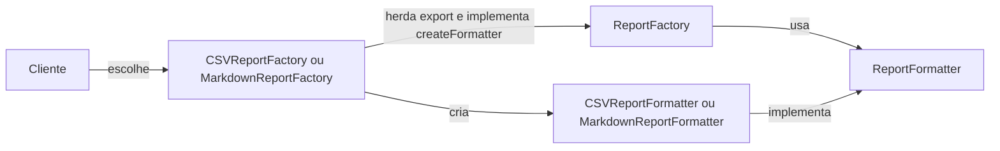

# Padrões de projeto: Singleton, Facade e Factory Method

> [!info] Sobre a numeração
> Esta nota está em **Aula10** porque é a próxima pasta da sequência de APOO neste repositório. O arquivo usado como fonte se apresenta como **“Aula 08 — Padrões de projeto: introdução”**, do Prof. Dr. Lucas Bueno R. Oliveira (IFSP, câmpus São Carlos). Os números das imagens abaixo são os números dos slides, não o número da pasta.

## 1. Por que estudar padrões de projeto?

Depois de entender o domínio e decidir **o que** o software deve fazer, ainda é preciso projetar **como** as classes vão colaborar. Problemas como criação de objetos, dependências entre módulos e compartilhamento de estado reaparecem em muitos sistemas. Um **padrão de projeto** descreve uma solução geral já estudada para um problema recorrente; ele precisa ser adaptado ao contexto, não copiado mecanicamente.

Ao estudar um padrão, procure quatro partes:

| Parte | Pergunta que responde |
| --- | --- |
| **Nome** | Como conversar sobre essa solução? |
| **Problema** | Em que situação ela é útil? |
| **Solução** | Quais classes e relações são propostas? |
| **Consequências** | O que melhora e que custo aparece? |

Os 23 padrões do catálogo *Design Patterns* são agrupados em **criacionais** (criação de objetos), **estruturais** (composição de classes e objetos) e **comportamentais** (distribuição de responsabilidades e comunicação). Nesta aula, **Singleton** e **Factory Method** são criacionais; **Facade** é estrutural. Isso é uma classificação, não uma obrigação de usar um padrão de cada grupo.

| Padrão | Pergunta principal | Ideia em uma frase |
| --- | --- | --- |
| Singleton | Quantas instâncias existirão? | A classe controla sua única instância e oferece acesso centralizado. |
| Facade | Como simplificar o uso de um subsistema? | Uma fachada oferece uma entrada simples e delega o trabalho às classes internas. |
| Factory Method | Quem decide a classe concreta a criar? | Subclasses escolhem o produto, enquanto o código de uso trabalha com uma abstração. |

## 2. Singleton: uma instância com acesso centralizado

### Problema e estrutura

Às vezes, várias instâncias de um recurso compartilhado poderiam desperdiçar recursos ou produzir estados inconsistentes. Os slides citam cache, pool de threads, preferências e logging como **possíveis contextos**, não como justificativa automática para aplicar Singleton.

O padrão esconde o construtor e fornece um método estático que devolve a instância controlada pela classe:

![[Slide 08 - Singleton.png|800]]

*Slide 8: estrutura da classe Singleton. O sinal `-` indica membro privado; `+` indica membro público. O atributo e a operação sublinhados são estáticos na notação UML.*

### Exemplo 1: inicialização tardia em uma única thread

O primeiro exemplo dos slides cria o objeto somente na primeira chamada de `getInstance()`:

```java
public final class Singleton {
    private static Singleton instance;

    private Singleton() {}

    public static Singleton getInstance() {
        if (instance == null) {
            instance = new Singleton();
        }
        return instance;
    }

    public void doSomething() {
        // Funcionalidade compartilhada.
    }
}
```

```java
Singleton a = Singleton.getInstance();
Singleton b = Singleton.getInstance();
System.out.println(a == b); // true, se o acesso ocorreu em uma única thread
```

**Atenção:** essa implementação não é segura quando duas threads chamam `getInstance()` simultaneamente antes da primeira criação. Ambas podem observar `null` e construir objetos diferentes.

### Exemplo 2: inicialização tardia com concorrência

O segundo exemplo dos slides usa *double-checked locking*: uma verificação rápida antes da trava e outra dentro dela. `volatile` garante a visibilidade adequada da referência entre threads.

```java
public final class Singleton {
    private static volatile Singleton instance;

    private Singleton() {}

    public static Singleton getInstance() {
        Singleton result = instance;
        if (result != null) return result;

        synchronized (Singleton.class) {
            if (instance == null) {
                instance = new Singleton();
            }
            return instance;
        }
    }
}
```

Na primeira chamada, uma thread entra no bloco sincronizado e cria a instância. Se outra thread chegar ao mesmo tempo, espera; ao entrar, a **segunda verificação** encontra a instância já criada. Nas chamadas seguintes, a primeira verificação evita obter a trava. O exemplo presume acesso normal pelo método da classe; mecanismos como reflexão ou desserialização exigem cuidados adicionais se a unicidade for uma exigência rígida.

### Consequências

- **Vantagem:** uma instância controlada e acesso centralizado; nos dois exemplos, a criação é tardia.
- **Custo:** o estado compartilhado pode tornar testes dependentes uns dos outros, esconder dependências e aumentar o acoplamento.
- **Limite:** uma única instância pode virar gargalo quando o trabalho precisaria ser distribuído.

> [!warning] Regra de decisão
> Antes de usar Singleton, pergunte se o sistema realmente precisa de **uma única instância** ou apenas de **um objeto compartilhado**. No segundo caso, fornecer esse objeto explicitamente às classes que o usam costuma deixar as dependências mais claras.

## 3. Facade: uma entrada simples para um subsistema complexo

### Problema e solução

Imagine que um cliente queira transferir dinheiro, mas precise conhecer repositórios, autenticação, serviços e modelos de requisição de uma API externa. O cliente passa a depender de detalhes que não fazem parte de sua responsabilidade. Se a API mudar, muitos clientes podem precisar ser alterados.

A **fachada** apresenta operações próximas do que o cliente deseja fazer. Ela conhece as classes internas e **delega** a elas a execução real. O subsistema continua existindo; a fachada organiza o acesso a ele.

![[Slide 14 - Facade.png|900]]

*Slide 14: à esquerda, cada cliente se liga diretamente a várias classes; à direita, os clientes usam a fachada como ponto de entrada.*

### Exemplo dos slides: transferência bancária

Antes da fachada, `TransferClient` precisa montar uma cadeia de dependências para fazer uma única chamada (slide 19):

```java
AuthenticationRepository authRepo = new PostgresAuthenticationRepository();
CheckingAccountRepository accountRepo = new AWSCheckingAccountRepository();
AuthenticationService authService = new AuthenticationService(authRepo);
TransferService transferService = new TransferService(accountRepo, authService);

TransferRequestModel request = new TransferRequestModel(
    srcAccount, srcBranch, password, destAccount, destBranch, amount
);
return transferService.process(request);
```

O serviço de transferência ainda precisa autenticar a conta de origem, localizar as duas contas, debitar, creditar e atualizar a persistência (slides 16–18). Essas regras **continuam no subsistema** após a mudança; o padrão não as reimplementa no cliente.

Nos slides 21–22, `CheckingAccountFacade` concentra a montagem dos serviços e expõe duas operações: `withdraw(...)` e `transfer(...)`. Abaixo está o trecho essencial, reunido e formatado a partir dos dois slides:

```java
public class CheckingAccountFacade {
    private final WithdrawService withdrawService;
    private final TransferService transferService;

    public CheckingAccountFacade() {
        AuthenticationRepository authRepo = new PostgresAuthenticationRepository();
        CheckingAccountRepository accountRepo = new AWSCheckingAccountRepository();
        AuthenticationService authService = new AuthenticationService(authRepo);
        this.withdrawService = new WithdrawService(accountRepo, authService);
        this.transferService = new TransferService(accountRepo, authService);
    }

    public boolean withdraw(String account, String branch,
                            String password, double amount) {
        var request = new WithdrawRequestModel(account, branch, password, amount);
        return withdrawService.process(request);
    }

    public boolean transfer(String srcAccount, String srcBranch, String password,
                            String destAccount, String destBranch, double amount) {
        var request = new TransferRequestModel(
            srcAccount, srcBranch, password, destAccount, destBranch, amount
        );
        return transferService.process(request);
    }
}
```

Agora o código cliente pode trabalhar com a operação que realmente deseja executar (slide 23):

```java
CheckingAccountFacade facade = new CheckingAccountFacade();
boolean transferred = facade.transfer(
    "123", "001", "senha", "456", "001", 100.00
);
```

**O que mudou?** O cliente deixou de montar `AuthenticationRepository`, `AuthenticationService`, `CheckingAccountRepository`, `TransferService` e `TransferRequestModel`. A fachada ainda usa essas classes, mas seus detalhes ficam em um lugar só. A criação direta de implementações concretas dentro do construtor é uma escolha **didática do slide**; em uma aplicação maior, elas podem ser fornecidas à fachada por configuração ou injeção de dependências.

### Consequências e relação com DDD

- **Benefício:** menos dependências visíveis no cliente e menor impacto quando a implementação interna do subsistema muda.
- **Benefício:** uma fachada entre módulos do próprio sistema também pode deixar as fronteiras mais claras.
- **Custo:** uma fachada genérica demais pode crescer sem controle ou impedir acesso a operações especializadas. Múltiplas fachadas podem servir a grupos diferentes de clientes.

Os slides relacionam Facade à ideia de **Camada Anticorrupção** do [[APOO/Aula8/DDD|DDD]]. Uma fachada pode compor essa camada, mas uma camada anticorrupção também **traduz conceitos e modelos** entre contextos; apenas oferecer métodos mais simples não garante essa tradução.

## 4. Factory Method: separar a escolha do produto de seu uso

### Problema e estrutura

Quando uma classe precisa usar um objeto, ela nem sempre deveria decidir diretamente qual classe concreta instanciar. Se o mesmo algoritmo deve funcionar com produtos diferentes, vários `new` e condicionais espalhados pelo código dificultam extensões.

No **Factory Method**, uma classe criadora define o trabalho comum e declara um método de criação que retorna a **abstração do produto**. Cada criadora concreta sobrescreve esse método para escolher o produto concreto.

![[Slide 29 - Factory Method.png|900]]

*Slide 29: `ReportFactory` usa `ReportFormatter`; `CSVReportFactory` e `MarkdownReportFactory` escolhem formatadores diferentes. O desenho mostra separadamente a hierarquia das fábricas e a dos produtos.*



### Exemplo dos slides: relatórios CSV e Markdown

O algoritmo comum de exportação pede um formatador, formata os dados e grava o arquivo (slide 30). O ponto de extensão é `createFormatter()`:

```java
public abstract class ReportFactory {
    public <T extends Reportable> void export(List<T> data, String destination)
            throws IOException {
        ReportFormatter formatter = createFormatter(); // factory method
        String output = formatter.format(data);

        try (FileWriter writer = new FileWriter(new File(destination))) {
            writer.write(output);
        }
    }

    protected abstract ReportFormatter createFormatter();
}

public interface ReportFormatter {
    <T extends Reportable> String format(List<T> content);
}

public interface Reportable {
    String[] toReport();
}
```

`Reportable` define como cada item fornece colunas. Nos slides 35–36, `Header` fornece nomes de colunas e `Course` fornece dados como nome, código, dia e horários. As criadoras concretas definem apenas qual formatador usar (slide 35):

```java
public class CSVReportFactory extends ReportFactory {
    @Override
    protected ReportFormatter createFormatter() {
        return new CSVReportFormatter();
    }
}

public class MarkdownReportFactory extends ReportFactory {
    @Override
    protected ReportFormatter createFormatter() {
        return new MarkdownReportFormatter();
    }
}
```

O produto CSV transforma cada linha em campos separados por `;` (slide 32; aspas normalizadas para Java válido):

```java
public class CSVReportFormatter implements ReportFormatter {
    @Override
    public <T extends Reportable> String format(List<T> content) {
        return content.stream()
            .map(Reportable::toReport)
            .map(row -> String.join(";", row))
            .collect(Collectors.joining("\n"));
    }
}
```

O produto Markdown usa a primeira linha como cabeçalho, cria uma linha separadora e formata as demais linhas como tabela (slides 33–34):

```java
public class MarkdownReportFormatter implements ReportFormatter {
    @Override
    public <T extends Reportable> String format(List<T> content) {
        if (content == null || content.isEmpty()) return "";

        String[] header = content.getFirst().toReport();
        String headerRow = row(header);
        String separator = "|" + IntStream.range(0, header.length)
            .mapToObj(i -> " --- ").collect(Collectors.joining("|")) + "|";
        String dataRows = content.stream().skip(1)
            .map(Reportable::toReport)
            .map(MarkdownReportFormatter::row)
            .collect(Collectors.joining("\n"));

        return String.join("\n", headerRow, separator, dataRows);
    }

    private static String row(String[] values) {
        return "|" + String.join(" | ", values) + " |";
    }
}
```

```java
List<Reportable> content = List.of(
    new Header("Name", "Code", "Day", "Start Time", "End Time"),
    new Course("Object-Oriented Design", "APOO", DayOfWeek.WEDNESDAY,
        LocalTime.of(8, 0), LocalTime.of(9, 40))
);

ReportFactory csv = new CSVReportFactory();
csv.export(content, "report.csv");

ReportFactory markdown = new MarkdownReportFactory();
markdown.export(content, "report.md");
```

O cliente escolhe **qual fábrica** usar; `export()` permanece igual. Para acrescentar um novo formato, cria-se outro `ReportFormatter` e outra `ReportFactory` concreta, sem alterar o algoritmo de `export()`. `getFirst()` requer Java 21 ou mais recente. Os trechos foram separados por papel didático; em Java, cada classe ou interface pública deve ficar em seu próprio arquivo.

> [!note] Limites do exemplo de formatação
> O CSV do slide junta valores com `;`, mas não escapa separadores, aspas ou quebras de linha dentro dos dados. O formatador Markdown também não escapa `|` dentro de células. Em produção, isso exigiria tratamento específico ou uma biblioteca apropriada.

### Consequências

- **Benefício:** o código comum depende de `ReportFormatter`, não de `CSVReportFormatter` ou `MarkdownReportFormatter`.
- **Benefício:** novos produtos podem ser introduzidos com novas criadoras, preservando o algoritmo de exportação.
- **Custo:** surgem mais classes e, nessa forma, uma hierarquia por herança. Se há uma única criação trivial, o padrão pode complicar o projeto sem trazer ganho.

Não confunda **Factory Method** com qualquer método que contenha `new`: aqui o método de criação é um **ponto de extensão** que as subclasses implementam, enquanto a classe base usa o produto por sua interface.

## 5. Como escolher entre os três?

| Situação | Padrão a considerar | O que ele resolve |
| --- | --- | --- |
| O sistema exige uma instância controlada de determinada classe. | Singleton | Controla a quantidade e o acesso à instância. |
| Clientes precisam conhecer muitas classes internas para executar uma operação simples. | Facade | Esconde a montagem e oferece operações mais diretas. |
| Um algoritmo usa produtos intercambiáveis, cuja classe concreta varia. | Factory Method | Deixa a escolha do produto nas criadoras concretas. |

Os padrões também podem coexistir: uma fachada pode usar uma fábrica para obter um serviço, por exemplo. O importante é localizar o **problema real** antes de adicionar classes ao projeto.

## 6. Exercício do slide 40: `MyLog`

Implemente um Singleton `MyLog` com `setPriority()` e `log(mensagem, nível)`, usando os níveis `INFORMATION`, `WARNING` e `ERROR`. A mensagem aparece quando sua prioridade é **igual ou superior** à prioridade configurada:

| Configuração | Information | Warning | Error |
| --- | --- | --- | --- |
| Information | imprime | imprime | imprime |
| Warning | ignora | imprime | imprime |
| Error | ignora | ignora | imprime |

**Para pensar antes de codificar:** qual das duas implementações de Singleton usar se várias threads puderem chamar `getInstance()`? O nível configurado também será alterado por várias threads? Como testar o logger sem deixar o estado global de um teste afetar o próximo?

> [!warning] Divergência no enunciado do slide
> Uma frase do slide 40 diz que a configuração *Warning* imprime mensagens de aviso e informativas, mas o exemplo logo abaixo diz que *Information* deve ser ignorada e *Error* impressa. A tabela acima segue a regra “nível igual ou superior” e esse exemplo, que são consistentes entre si.

## 7. Revisão rápida

1. **Padrão de projeto** = problema recorrente + solução adaptável + consequências conhecidas.
2. **Singleton** controla uma instância; concorrência e estado global exigem atenção.
3. **Facade** simplifica o acesso a um subsistema; as regras continuam nas classes que as implementam.
4. **Factory Method** mantém o algoritmo de uso na criadora base e delega às subclasses a escolha do produto.
5. O padrão certo é aquele que resolve uma dificuldade presente no projeto com um custo aceitável.

**Fonte principal:** *Aula 08 — Padrões de projeto: introdução*, Prof. Dr. Lucas Bueno R. Oliveira, APOO, IFSP São Carlos, slides 1–41. As imagens são capturas dos slides 8, 14 e 29; os trechos Java foram selecionados e, quando indicado, formatados ou ajustados para facilitar a leitura.
