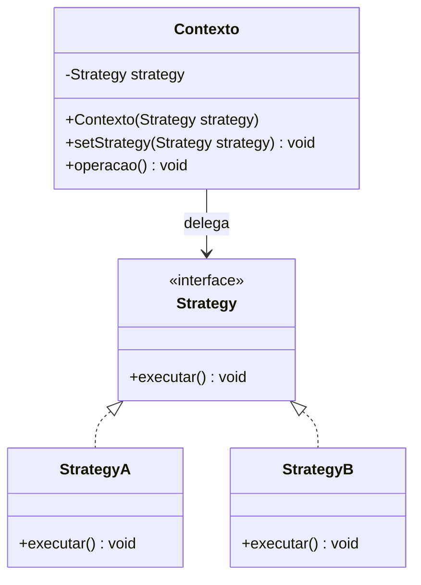
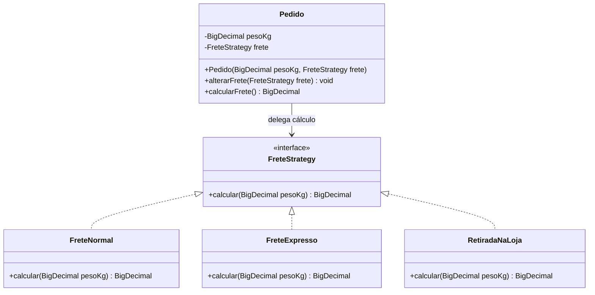

# Strategy: variação de algoritmos

O **Strategy** é um padrão de projeto **comportamental** que define uma família de algoritmos, encapsula cada um em uma implementação e permite que sejam usados de forma intercambiável por um contexto. A escolha do algoritmo fica separada do trabalho que o utiliza.

## 1. Problema

Imagine um sistema de vendas que calcula o frete de um pedido. A entrega pode ser normal, expressa ou retirada na loja. Cada modalidade tem uma regra diferente, mas o restante do processamento do pedido continua igual.

Uma primeira solução seria colocar todas as regras dentro de `Pedido`:

```java
// Trecho ilustrativo: as regras estão concentradas no pedido.
if (tipoEntrega.equals("NORMAL")) {
    frete = 10.0;
} else if (tipoEntrega.equals("EXPRESSA")) {
    frete = 25.0;
} else if (tipoEntrega.equals("RETIRADA")) {
    frete = 0.0;
}
```

Se aparecer uma nova modalidade, essa classe precisará ser alterada. À medida que as regras crescerem, o mesmo método pode acumular condicionais e responsabilidades diferentes. O problema não é a existência de um `if` isolado: Strategy é útil quando há **variações reais de comportamento** que precisam evoluir ou ser escolhidas separadamente.

## 2. Solução e estrutura

O padrão propõe extrair cada algoritmo para um objeto próprio, todos com um **contrato comum**. O contexto mantém uma referência a esse contrato e delega a execução à estratégia recebida. O cliente escolhe e fornece uma implementação ao contexto.



- **Contexto:** realiza seu trabalho e delega a parte variável à estratégia.
- **Strategy:** declara a operação comum às alternativas.
- **Estratégias concretas:** implementam o mesmo contrato com algoritmos diferentes.
- **Cliente:** escolhe a estratégia e a fornece ao contexto; pode substituí-la quando o contexto permitir.

No diagrama, a seta com triângulo tracejado indica que as classes concretas **implementam** a interface; a associação do contexto indica que ele mantém e usa uma estratégia. O cliente precisa conhecer as alternativas para escolher, mas o contexto não precisa conhecer as classes concretas. A troca em tempo de execução é possível, porém não é obrigatória: uma estratégia também pode ser definida apenas na criação do contexto.

## 3. Exemplo: cálculo de frete

Neste exemplo didático, a regra normal cobra R$ 10,00 fixos mais R$ 2,00 por quilograma; a expressa cobra R$ 25,00 mais R$ 5,00 por quilograma; a retirada é gratuita. São valores **fictícios**, usados para mostrar a estrutura, não regras reais de transporte.



### Código Java

O exemplo abaixo está completo em um único arquivo `SeminarioStrategy.java`. Usa `BigDecimal` para evitar imprecisões de ponto flutuante nos valores monetários. Em um projeto maior, cada classe poderia ficar em seu próprio arquivo.

```java
import java.math.BigDecimal;
import java.math.RoundingMode;
import java.util.Objects;

interface FreteStrategy {
    BigDecimal calcular(BigDecimal pesoKg);
}

class FreteNormal implements FreteStrategy {
    @Override
    public BigDecimal calcular(BigDecimal pesoKg) {
        return new BigDecimal("10.00")
            .add(new BigDecimal("2.00").multiply(pesoKg));
    }
}

class FreteExpresso implements FreteStrategy {
    @Override
    public BigDecimal calcular(BigDecimal pesoKg) {
        return new BigDecimal("25.00")
            .add(new BigDecimal("5.00").multiply(pesoKg));
    }
}

class RetiradaNaLoja implements FreteStrategy {
    @Override
    public BigDecimal calcular(BigDecimal pesoKg) {
        return BigDecimal.ZERO;
    }
}

class Pedido {
    private final BigDecimal pesoKg;
    private FreteStrategy frete;

    public Pedido(BigDecimal pesoKg, FreteStrategy frete) {
        this.pesoKg = Objects.requireNonNull(pesoKg, "peso obrigatório");
        if (pesoKg.signum() <= 0) {
            throw new IllegalArgumentException("O peso deve ser positivo");
        }
        alterarFrete(frete);
    }

    public void alterarFrete(FreteStrategy frete) {
        this.frete = Objects.requireNonNull(frete, "frete obrigatório");
    }

    public BigDecimal calcularFrete() {
        return frete.calcular(pesoKg).setScale(2, RoundingMode.HALF_UP);
    }
}

public class SeminarioStrategy {
    public static void main(String[] args) {
        Pedido pedido = new Pedido(new BigDecimal("3.0"), new FreteNormal());
        System.out.println("Normal: R$ " + pedido.calcularFrete());

        pedido.alterarFrete(new FreteExpresso());
        System.out.println("Expresso: R$ " + pedido.calcularFrete());

        pedido.alterarFrete(new RetiradaNaLoja());
        System.out.println("Retirada: R$ " + pedido.calcularFrete());
    }
}
```

Para executar com um JDK instalado:

```sh
javac SeminarioStrategy.java
java SeminarioStrategy
```

Saída esperada:

```text
Normal: R$ 16.00
Expresso: R$ 40.00
Retirada: R$ 0.00
```

**Fluxo:** o cliente cria `Pedido` com `FreteNormal`; ao chamar `calcularFrete()`, o pedido delega o cálculo à estratégia. Depois, o cliente troca a estratégia e o mesmo pedido passa a usar outro algoritmo. Para incluir uma modalidade, é possível criar outra implementação de `FreteStrategy` sem alterar `Pedido`. A parte que **seleciona** a modalidade ainda precisa conhecer ou receber a nova opção; Strategy não elimina automaticamente essa decisão.

> [!note] Escopo do exemplo
> O código trata apenas o cálculo didático. Um sistema real precisaria considerar destino, dimensões, limites, disponibilidade e regras comerciais; todas as estratégias devem respeitar o mesmo contrato para que sejam intercambiáveis.

## 4. Consequências

**Vantagens:**

- Separa os algoritmos do contexto e facilita compreender e testar cada regra isoladamente.
- Permite adicionar estratégias sem modificar o contexto, desde que o contrato continue suficiente. Isso favorece o princípio aberto/fechado, mas a seleção e a configuração da nova estratégia ainda podem exigir mudanças.
- Permite trocar o comportamento de um objeto durante sua vida, quando o projeto oferece essa possibilidade.
- Usa composição e delegação para variar o comportamento, sem exigir uma subclasse de `Pedido` para cada modalidade.

**Custos e cuidados:**

- Introduz interface, implementações e configuração adicionais; para poucas regras simples e estáveis, uma condicional pode ser mais clara.
- O cliente ou outra parte do sistema precisa decidir qual estratégia usar e compreender as diferenças entre elas.
- Todas as estratégias precisam cumprir o contrato; se precisarem de dados muito diferentes, uma interface comum pode ficar inadequada ou exigir parâmetros desnecessários.
- Trocar estratégia em objetos compartilhados exige cuidado com concorrência e com o momento da mudança.

## 5. Exemplo na biblioteca Java: `Comparator`

A interface [`Comparator`](https://docs.oracle.com/en/java/javase/21/docs/api/java.base/java/util/Comparator.html) representa uma regra de comparação que pode ser fornecida a operações de ordenação. O mesmo mecanismo de ordenação pode receber critérios diferentes, uma aplicação da ideia de Strategy:

```java
List<String> nomes = new ArrayList<>(List.of("Ana", "Beatriz", "Caio"));
nomes.sort(Comparator.naturalOrder());             // ordem alfabética
nomes.sort(Comparator.comparingInt(String::length)); // ordem por tamanho
```

Nesse trecho, acrescente os imports de `java.util.List`, `java.util.ArrayList` e `java.util.Comparator`. O critério de comparação é intercambiável; a lista não precisa conhecer antecipadamente cada regra. Comparadores devem respeitar o contrato de ordenação descrito na documentação.

## 6. Exercício proposto

Um serviço de notificações precisa enviar mensagens por **e-mail**, **SMS** ou **notificação no aplicativo**. Cada canal recebe o mesmo texto, mas tem sua própria forma de envio.

1. Desenhe um diagrama de classes com o contexto, o contrato comum e as três estratégias concretas.
2. Implemente uma interface `CanalNotificacao` com `enviar(String mensagem)`. Para o exercício, simule os envios com mensagens no console; não é necessário integrar serviços externos.
3. Implemente `ServicoNotificacao`, que recebe um canal e delega o envio. Permita trocar o canal e demonstre os três comportamentos com a mesma instância do serviço.
4. Acrescente um novo canal sem modificar a lógica de envio do contexto. Explique onde a escolha do novo canal precisa ser feita.
5. Discuta se o padrão continuaria valendo a pena se existisse apenas um canal e não houvesse previsão de outros.

**Critérios de conferência:** cada estratégia implementa o mesmo contrato; o serviço depende da interface; a escolha fica fora do serviço; a saída identifica o canal utilizado. O diagrama deve representar implementação da interface e associação do contexto com ela.

## 7. Revisão rápida

1. **Problema:** uma parte do comportamento varia e suas alternativas se acumulam no contexto.
2. **Solução:** encapsular algoritmos em estratégias com um contrato comum e delegar a execução.
3. **Escolha:** o cliente fornece a estratégia; a troca durante a execução é possível, mas opcional.
4. **Consequências:** mais flexibilidade e separação de responsabilidades, ao custo de mais elementos e configuração.

## Referências e preparação do seminário

- *Aula 08 — Padrões de projeto: introdução*, Prof. Dr. Lucas Bueno R. Oliveira, IFSP São Carlos: organização por problema, solução, estrutura, exemplos e consequências. Strategy aparece na classificação dos padrões comportamentais; o exemplo de frete desta nota foi elaborado para estudo.
- *Seminário sobre Padrões de Projeto*, Prof. Dr. Lucas Oliveira: requisitos de slides, diagramas, código, consequências e exercício.
- Gamma, Helm, Johnson e Vlissides. *Design Patterns: Elements of Reusable Object-Oriented Software*. Padrão Strategy.
- [Documentação Java: `Comparator`](https://docs.oracle.com/en/java/javase/21/docs/api/java.base/java/util/Comparator.html).

O enunciado solicita apresentação em **trio**, entre **20 e 30 minutos**, entrega dos slides pelo **Moodle** e link para um **repositório com a implementação**. Esta nota é material de estudo para preparar a apresentação; o link do repositório deve ser acrescentado quando a equipe publicar o código. A lista de tecnologias que utilizam o padrão é indicada como extra no enunciado.
