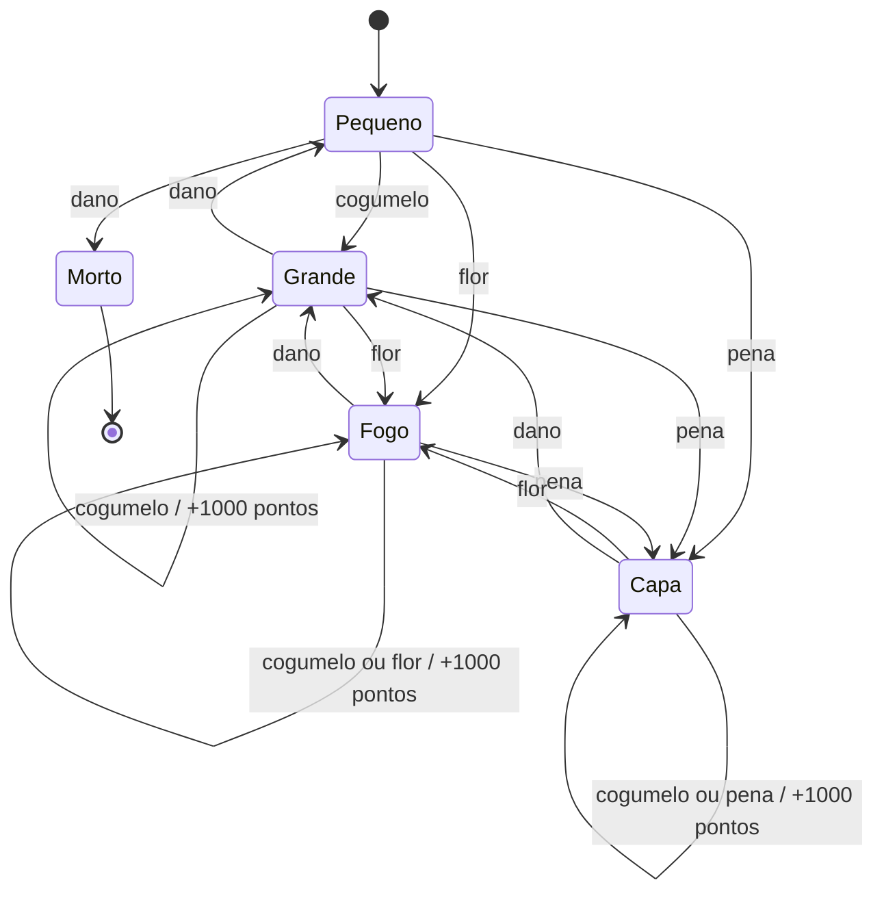
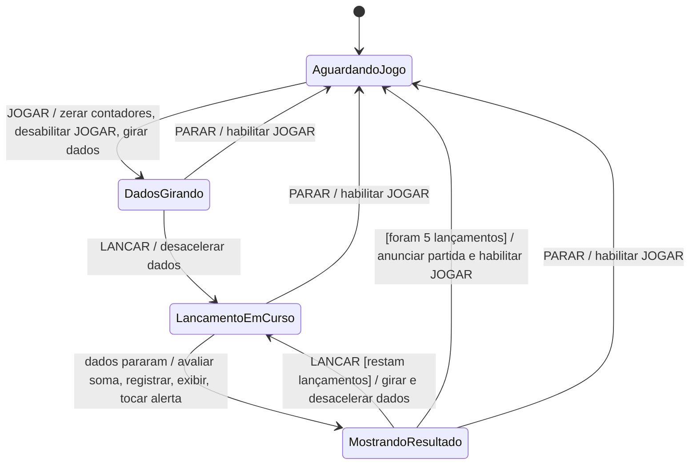

# Diagrama de Estados e Padrão State

> [!info] Sobre a numeração
> Esta nota está em **Aula11** porque a pasta Aula10 já existe neste repositório. O PDF fornecido se apresenta como **“Aula 09 — Diagrama de Estados e Padrão State”**, do Prof. Dr. Lucas Bueno R. Oliveira (IFSP, câmpus São Carlos). Os números nas legendas das imagens indicam os **slides do PDF**.

## 1. Ideia central da aula

Até aqui, os diagramas de classes mostraram a estrutura do sistema, e os diagramas de sequência e atividade ajudaram a descrever interações e fluxos. O **diagrama de estados** responde a outra pergunta: **como o comportamento de uma entidade muda ao longo do tempo?**

Um pedido pode estar pendente, pago ou enviado. Uma ligação pode estar ociosa, discando ou conectada. Em cada condição, os mesmos eventos podem ter efeitos diferentes. A aula parte da modelagem desse ciclo de vida, mostra uma implementação direta em Java e, depois, aplica o **padrão State** para organizar comportamentos que dependem do estado.

O caminho de estudo é:

1. Entender estados, eventos, guardas e transições.
2. Ler um diagrama com estados compostos e ações de entrada, permanência e saída.
3. Observar por que um `enum` com vários `switch` pode dificultar a inclusão de estados.
4. Separar os comportamentos em objetos de estado com o padrão State.

## 2. Máquina de estados e diagrama UML

Uma **máquina de estados finita** (MEF) possui um conjunto finito de estados e regras que determinam o que acontece quando um evento ocorre. No diagrama UML, ela pode descrever o ciclo de vida de **um objeto**, de um caso de uso ou até do sistema inteiro (slide 4).

| Elemento | Significado | Exemplo |
| --- | --- | --- |
| **Estado** | Condição da entidade durante um intervalo de tempo. | `Pendente`, `Pago`, `Enviado` |
| **Evento** | Ocorrência que pode disparar uma mudança. | `confirmarPagamento()` |
| **Transição** | Passagem de um estado a outro. | `Pendente` → `Pago` |
| **Guarda** | Condição booleana que permite uma transição. | `[pagamentoAprovado]` |
| **Efeito da transição** | Ação executada quando aquela passagem ocorre. | `/ emitirRecibo()` |
| **Pseudoestado inicial** | Ponto de entrada da máquina; desenhado como círculo preenchido. | Início → `Pendente` |
| **Estado final** | Término do ciclo; desenhado como círculo com borda e centro preenchido. | `Enviado` → fim |
| **Pseudoestado de decisão** | Ramificação representada por um losango. | Escolher caminho conforme uma guarda |

![[Slide 05 - Elementos do diagrama.png|900]]

*Slide 5: símbolos de estado, início, decisão e fim, além de ações de entrada, permanência e saída. É o diagrama mostrado na segunda imagem enviada para esta correção.*

### Como ler uma seta

A forma apresentada no slide 6 é **`evento [condição] / comportamento`**. Os elementos após o evento podem ser omitidos quando não se aplicam.

```text
Pendente ── confirmarPagamento() [aprovado] / emitirRecibo() ──▶ Pago
```

Isso significa: quando `confirmarPagamento()` ocorre **enquanto o objeto está em `Pendente`**, a guarda `aprovado` é verificada. Se for verdadeira, `emitirRecibo()` é executado na transição e o próximo estado passa a ser `Pago`. A seta não diz, sozinha, o que fazer se a guarda for falsa; esse caso precisa ser definido em outra transição ou regra.

![[Slide 06 - Transicoes no Truco.png|750]]

*Slide 6: diagrama de uma mão de Truco, usado na aula para apontar eventos, guardas, ações e transições.*

### Ações de estado e ações de transição

No estado `Waiting Response` do Truco, o slide distingue:

- **`entry / ...`**: ação ao **entrar** no estado;
- **`do / ...`**: atividade realizada **durante** a permanência;
- **`exit / ...`**: ação ao **sair** do estado.

Já o texto após `/` na **seta** representa uma ação daquela **transição** específica. Essa distinção importa quando várias setas chegam ou saem do mesmo estado: uma ação de entrada é associada ao estado; um efeito de transição é associado apenas à seta percorrida.

> [!example] Exemplo próprio: pedido de compra
> `PedidoPendente` pode receber `pagar()`. Se `[pagamentoAprovado]`, a transição executa `/ registrarPagamento()` e chega a `PedidoPago`. Se `[pagamentoRecusado]`, pode continuar em `PedidoPendente` e registrar a tentativa. O evento é o mesmo; a guarda decide o caminho.

## 3. Estados aninhados

Quando um estado possui etapas internas relevantes, ele pode ser detalhado como um **estado composto**. No exemplo do telefone (slide 7), a visão simples mostra `Ocioso` e `Ativo`. A visão detalhada abre `Ativo` em `Sinal de Linha`, `Discando`, `Conectando` e `Falando`.

![[Slide 07 - Estados aninhados.png|1000]]

*Slide 7: à esquerda, `Ativo` aparece como submáquina não detalhada; à direita, o estado composto revela as etapas da ligação.*

O detalhe ajuda a responder perguntas que o diagrama simples não mostra, como: **o que acontece depois de cada dígito?** e **quando a ligação passa a estar conectada?** O ciclo externo continua compreensível: iniciar a ligação sai de `Ocioso`, e encerrar a ligação retorna a `Ocioso`.

> [!tip] Como escolher o nível de detalhe
> Modele apenas estados que fazem diferença para os eventos e regras que você precisa explicar. Uma diferença visual na interface não precisa virar estado se não alterar o comportamento da entidade.

## 4. Do diagrama para o código: abordagem com `enum`

Nos slides 8 e 9, a mão de Truco guarda o estado em um `enum` com valores como `NO_CARD`, `ONE_CARD` e `WAITING_RESPONSE`. Cada evento vira um método (`playFirstCard`, `playSecondCard`, `raise`, `accept`, `fold`), e cada método decide o que fazer conforme o valor atual.

O trecho abaixo **simplifica a ideia dos slides**; os tipos auxiliares e regras completas do jogo foram omitidos:

```java
enum HandState { NO_CARD, ONE_CARD, WAITING_RESPONSE }

void fold(Player responder) {
    switch (state) {
        case NO_CARD, ONE_CARD ->
            throw new IllegalStateException("Não há proposta para desistir.");
        case WAITING_RESPONSE ->
            concluirMaoEmFavorDe(oponenteDe(responder));
    }
}
```

O ponto importante é que **o mesmo evento `fold` tem significados diferentes em estados diferentes**. Em alguns, é inválido; em outro, conclui a mão. O código com `enum` pode atender à especificação e funcionar bem. A dificuldade aparece quando a máquina cresce e muitos métodos repetem esse tipo de decisão.

### O que muda com a “mão de onze”?

Os slides 10 a 12 acrescentam `Waiting Mão de Onze`: quando um jogador chega a onze pontos, ele precisa decidir se joga a mão. Na versão com `enum`, é necessário adicionar o novo valor **e revisar cada método de evento** para definir o que acontece no novo estado. Esquecer um desses métodos pode deixar uma ação indevida disponível ou provocar um tratamento incompleto.

![[Slide 11 - Mao de onze.png|1000]]

*Slide 11: a máquina de Truco ganha uma ramificação inicial para `Waiting Mão de Onze`. A partir dela, aceitar segue para `No Card`; desistir encerra a mão.*

O problema de projeto que a aula destaca é a **dispersão das regras de um estado**: a regra de `Waiting Mão de Onze` fica espalhada por `playFirstCard`, `playSecondCard`, `accept`, `raise` e `fold` dentro da classe `Hand`.

## 5. Padrão de projeto State

O padrão **State** representa cada estado como um objeto que encapsula as respostas possíveis aos eventos. Ele é útil quando o comportamento de um objeto depende fortemente do estado atual e a inclusão de novos estados exige alterar muitas condicionais existentes (slide 13).

| Participante | Responsabilidade | No exemplo do Truco |
| --- | --- | --- |
| **Contexto** | Guarda os dados da entidade, mantém o objeto do estado atual e delega os eventos. | `Hand` |
| **Estado abstrato** | Define as operações que todos os estados precisam tratar. | `HandState` |
| **Estados concretos** | Implementam o comportamento próprio de cada estado e podem solicitar transições. | `NoCard`, `OneCard`, `WaitingResponse`, `WaitingMaoDeOnze` |

![[Slide 14 - Estrutura State.png|900]]

*Slide 14: estrutura geral. `Context.request()` delega ao objeto atual por meio da interface `AbstractState`; os estados concretos implementam `handle()`.*

![[Slide 15 - State no Truco.png|1000]]

*Slide 15: aplicação da estrutura geral à mão de Truco. `Hand` mantém um `HandState`, e as quatro classes concretas concentram as respostas aos eventos em seus respectivos estados.*

### Como ocorre uma transição no código

1. O cliente chama um método do **contexto**, como `hand.accept(responder)`.
2. `Hand` encaminha a chamada ao **estado atual**, como `state.accept(responder)`.
3. O estado concreto executa sua regra, altera os dados necessários do contexto e, se cabível, troca o estado atual por outro objeto.

Nos slides 16 e 17, `WaitingMaoDeOnze` rejeita jogar uma carta ou pedir aumento antes da decisão. Se o jogador **aceita**, o exemplo ajusta os pontos da mão para três, define quem começa e troca o estado para `NoCard`. Se **desiste**, conclui a mão em favor do oponente, com um ponto. Esses resultados pertencem à regra ilustrada nos slides; não são uma implementação completa do jogo de Truco.

### Exemplo próprio em Java: uma porta

O exemplo abaixo é **criado para esta nota**, apenas para deixar o mecanismo do padrão executável. A porta pode estar fechada, aberta ou trancada. Cada evento é delegado ao objeto que representa o estado atual.

```java
public class ExemploState {
    static class Porta {
        private EstadoPorta estado = new Fechada(this);

        void abrir() { estado.abrir(); }
        void fechar() { estado.fechar(); }
        void trancar() { estado.trancar(); }
        void destrancar() { estado.destrancar(); }
        String estadoAtual() { return estado.getClass().getSimpleName(); }

        private void mudarPara(EstadoPorta proximo) { estado = proximo; }
    }

    static abstract class EstadoPorta {
        protected final Porta porta;

        EstadoPorta(Porta porta) { this.porta = porta; }

        void abrir() { throw invalido("abrir"); }
        void fechar() { throw invalido("fechar"); }
        void trancar() { throw invalido("trancar"); }
        void destrancar() { throw invalido("destrancar"); }

        private IllegalStateException invalido(String evento) {
            return new IllegalStateException(
                "Não é possível " + evento + " em " + getClass().getSimpleName()
            );
        }
    }

    static class Fechada extends EstadoPorta {
        Fechada(Porta porta) { super(porta); }
        @Override void abrir() { porta.mudarPara(new Aberta(porta)); }
        @Override void trancar() { porta.mudarPara(new Trancada(porta)); }
    }

    static class Aberta extends EstadoPorta {
        Aberta(Porta porta) { super(porta); }
        @Override void fechar() { porta.mudarPara(new Fechada(porta)); }
    }

    static class Trancada extends EstadoPorta {
        Trancada(Porta porta) { super(porta); }
        @Override void destrancar() { porta.mudarPara(new Fechada(porta)); }
    }

    public static void main(String[] args) {
        Porta porta = new Porta();
        System.out.println(porta.estadoAtual()); // Fechada
        porta.abrir();
        System.out.println(porta.estadoAtual()); // Aberta
        porta.fechar();
        porta.trancar();
        System.out.println(porta.estadoAtual()); // Trancada
        porta.destrancar();
        System.out.println(porta.estadoAtual()); // Fechada
    }
}
```

Para executar, salve o trecho como `ExemploState.java` e rode `javac ExemploState.java && java ExemploState`. Tentar `abrir()` quando a porta está `Trancada` lança uma exceção. A classe `Porta` não contém um `switch` para decidir o que fazer: o método adequado está no estado concreto. A classe abstrata oferece a regra padrão de **evento inválido**, e cada estado sobrescreve apenas os eventos permitidos neste exemplo.

> [!warning] O que o padrão não resolve sozinho
> State não garante que toda transição seja correta. É preciso definir as regras, manter os dados do contexto coerentes e testar os caminhos importantes. Para uma máquina muito pequena e estável, um `enum` com decisões simples pode ser suficiente; o padrão adiciona classes e indireção.

## 6. Comparando as duas implementações

| Aspecto | `enum` e condicionais | Padrão State |
| --- | --- | --- |
| Onde ficam as regras de um estado? | Distribuídas pelos métodos de evento. | Agrupadas na classe do estado concreto. |
| Como um evento é tratado? | O método consulta o valor atual e escolhe um ramo. | O contexto delega ao objeto de estado atual. |
| O que acontece ao adicionar um estado? | Normalmente é preciso revisar os ramos de todos os eventos relevantes. | Cria-se uma classe nova e ajustam-se os pontos de transição necessários. |
| Custo inicial | Menos classes e mais código direto. | Mais tipos e delegação. |

A vantagem de evolução mostrada no slide 14 é **relativa ao código com decisões espalhadas**. Mesmo com State, uma nova regra pode exigir alterar outros estados que passam a apontar para o novo, o contrato de `HandState` ou a configuração da máquina. O ganho é ter responsabilidades mais localizadas, não tornar toda mudança automaticamente livre de edição.

## 7. Exercícios da aula e exemplos de leitura

### Exercício I: Mario Bros (slides 19 e 20)

O exercício pede (a) modelar o ciclo de vida do Mario em um diagrama de estados e (b) modelar e implementar o jogo com State, simulando eventos aleatórios e `Thread.sleep(tempo_milisegundos)`.

![[Slide 20 - Tabela Mario.png|900]]

*Slide 20: tabela de transições do exercício. Quando aparece “1000 pontos”, o estado continua o mesmo e somente a pontuação muda.*

Para ler a tabela, escolha a **linha do estado atual** e a **coluna do evento**. Se Mario está `Pequeno` e recebe `Cogumelo`, vai para `Grande`. Se já está `Fogo` e recebe `Flor`, ganha mil pontos e permanece `Fogo`. `Levar Dano` em `Pequeno` leva a `Morto`.

Esta é **uma solução de referência criada para a nota** para a parte (a), transcrevendo as transições do slide 20:



#### Resolução da parte (b): padrão State em Java

No código abaixo, `Mario` é o **contexto** e guarda pontuação e estado atual. `EstadoMario` é o contrato dos eventos. `Pequeno`, `Grande`, `Fogo`, `Capa` e `Morto` são os estados concretos. Cada método implementa exatamente a célula correspondente da tabela do slide 20. `Morto` encerra a simulação; receber eventos após o fim gera erro.

Salve como `MarioBrosState.java`. O exemplo usa Java 17 ou mais recente, sem bibliotecas externas, e pode ser executado com `javac MarioBrosState.java && java MarioBrosState`.

```java
import java.util.Random;

public class MarioBrosState {
    // O contrato agrupa os eventos que qualquer estado precisa tratar.
    interface EstadoMario {
        void cogumelo();
        void flor();
        void pena();
        void dano();
    }

    // Contexto: o cliente chama Mario, que delega ao estado atual.
    static class Mario {
        private EstadoMario estado = new Pequeno(this);
        private int pontos;

        void cogumelo() { estado.cogumelo(); }
        void flor() { estado.flor(); }
        void pena() { estado.pena(); }
        void dano() { estado.dano(); }

        void mudarPara(EstadoMario proximo) { estado = proximo; }
        void ganharMilPontos() { pontos += 1000; }
        boolean morreu() { return estado instanceof Morto; }
        String estadoAtual() { return estado.getClass().getSimpleName(); }
        int pontos() { return pontos; }
    }

    // Estado abstrato: só o estado terminal usa as respostas inválidas padrão.
    static abstract class EstadoBase implements EstadoMario {
        protected final Mario mario;

        EstadoBase(Mario mario) { this.mario = mario; }

        private IllegalStateException partidaEncerrada() {
            return new IllegalStateException("Mario já morreu; partida encerrada.");
        }

        public void cogumelo() { throw partidaEncerrada(); }
        public void flor() { throw partidaEncerrada(); }
        public void pena() { throw partidaEncerrada(); }
        public void dano() { throw partidaEncerrada(); }
    }

    static class Pequeno extends EstadoBase {
        Pequeno(Mario mario) { super(mario); }

        public void cogumelo() { mario.mudarPara(new Grande(mario)); }
        public void flor() { mario.mudarPara(new Fogo(mario)); }
        public void pena() { mario.mudarPara(new Capa(mario)); }
        public void dano() { mario.mudarPara(new Morto(mario)); }
    }

    static class Grande extends EstadoBase {
        Grande(Mario mario) { super(mario); }

        // Cogumelo repetido soma pontos sem trocar de estado.
        public void cogumelo() { mario.ganharMilPontos(); }
        public void flor() { mario.mudarPara(new Fogo(mario)); }
        public void pena() { mario.mudarPara(new Capa(mario)); }
        public void dano() { mario.mudarPara(new Pequeno(mario)); }
    }

    static class Fogo extends EstadoBase {
        Fogo(Mario mario) { super(mario); }

        public void cogumelo() { mario.ganharMilPontos(); }
        public void flor() { mario.ganharMilPontos(); }
        public void pena() { mario.mudarPara(new Capa(mario)); }
        public void dano() { mario.mudarPara(new Grande(mario)); }
    }

    static class Capa extends EstadoBase {
        Capa(Mario mario) { super(mario); }

        public void cogumelo() { mario.ganharMilPontos(); }
        public void flor() { mario.mudarPara(new Fogo(mario)); }
        public void pena() { mario.ganharMilPontos(); }
        public void dano() { mario.mudarPara(new Grande(mario)); }
    }

    static class Morto extends EstadoBase {
        Morto(Mario mario) { super(mario); }
        // Nenhuma transição sai de Morto no diagrama deste exercício.
    }

    public static void main(String[] args) throws InterruptedException {
        Mario mario = new Mario();
        Random aleatorio = new Random();
        String[] nomes = {"Cogumelo", "Flor", "Pena", "Dano"};

        System.out.println("Início: " + mario.estadoAtual());
        while (!mario.morreu()) {
            int evento = aleatorio.nextInt(nomes.length);

            // O sorteio só escolhe o evento; o estado decide seu efeito.
            switch (evento) {
                case 0 -> mario.cogumelo();
                case 1 -> mario.flor();
                case 2 -> mario.pena();
                case 3 -> mario.dano();
                default -> throw new AssertionError("Evento impossível");
            }

            System.out.printf("%s -> %s (%d pontos)%n",
                    nomes[evento], mario.estadoAtual(), mario.pontos());

            // Apenas dá ritmo à demonstração; não faz parte do padrão State.
            if (!mario.morreu()) Thread.sleep(300);
        }
    }
}
```

Por exemplo, se o sorteio produzir **Cogumelo, Flor, Flor, Dano, Dano, Dano**, a sequência será `Pequeno → Grande → Fogo → Fogo → Grande → Pequeno → Morto`, com **1000 pontos** pela segunda flor. O resultado de cada execução varia porque os eventos são aleatórios. A simulação termina somente quando Mario morre; em teoria, uma sequência aleatória pode demorar bastante até chegar a esse estado.

### Exercício II: jogo de dados (slides 21 e 22)

O enunciado do ENADE 2011 pede um diagrama para um jogo de **cinco lançamentos** com dois dados. Um lançamento é vencido quando a soma é **7 ou 11**; a partida é vencida pela maioria dos lançamentos. `JOGAR` inicia a partida e fica desabilitado; `LANÇAR` inicia o lançamento; `PARAR` encerra o jogo a qualquer momento e reabilita `JOGAR`.

#### Resolução: diagrama de estados do jogo

Esta é **uma solução criada para a nota**, baseada nos eventos e regras dos slides 21 e 22. `AguardandoJogo` significa que `JOGAR` está disponível. `DadosGirando` representa a animação logo após iniciar a partida. `LancamentoEmCurso` cobre a desaceleração até os dados pararem. `MostrandoResultado` mantém o resultado na tela até outro `LANÇAR` ou até a conclusão da partida.



**Regras executadas ao entrar em `MostrandoResultado`:**

```text
soma = dado1 + dado2
lancamentosFeitos += 1
se soma == 7 ou soma == 11:
    vitorias += 1
    mostrar "VENCEU" para este lançamento
senão:
    mostrar "PERDEU" para este lançamento
mostrar 5 - lancamentosFeitos como lançamentos restantes
tocar sinal sonoro

após o quinto lançamento:
    se vitorias >= 3: anunciar vitória da partida
    senão: anunciar derrota da partida
```

O jogador faz **cinco lançamentos**, mesmo que alcance três vitórias antes do quinto. A guarda `[restam lançamentos]` significa `lancamentosFeitos < 5`; o fim usa `lancamentosFeitos == 5`. O enunciado não descreve a tela após a quinta jogada. Nesta solução, o jogo anuncia o resultado da partida e reabilita `JOGAR`, preservando a possibilidade de iniciar outra partida. `PARAR` cancela a partida em qualquer estado ativo e também reabilita `JOGAR`. **“VENCEU” ou “PERDEU” em cada jogada é o resultado do lançamento, não o placar final da partida.**

## 8. Resumo para revisão

- **Estado** descreve a condição da entidade; **evento** pode disparar uma **transição**.
- Uma transição pode ter **guarda** e **efeito**. Ações `entry`, `do` e `exit` pertencem ao estado.
- **Estados compostos** detalham fases internas sem perder a visão do ciclo externo.
- A implementação com `enum` é direta, mas pode espalhar regras quando muitos eventos dependem do estado.
- **State** concentra comportamentos em classes de estado e faz o contexto delegar ao estado atual.
- A escolha entre as abordagens depende da complexidade da máquina e da frequência com que seus estados e regras mudam.

**Fonte da aula:** PDF “Aula 09 — Diagrama de Estados e Padrão State”, slides 1–23, Prof. Dr. Lucas Bueno R. Oliveira, IFSP, câmpus São Carlos. Os trechos marcados como exemplos ou soluções próprias foram elaborados para estudo e não são transcrições dos slides.
