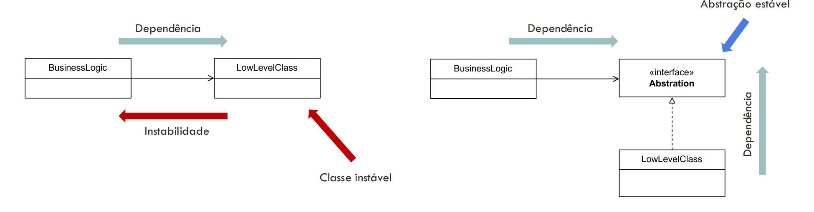
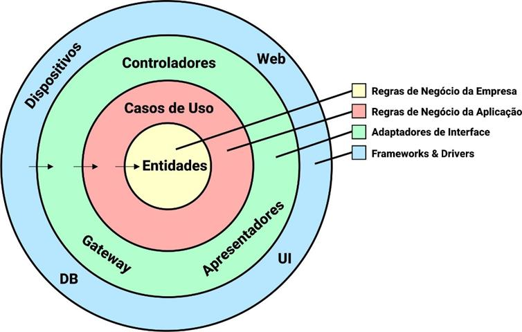
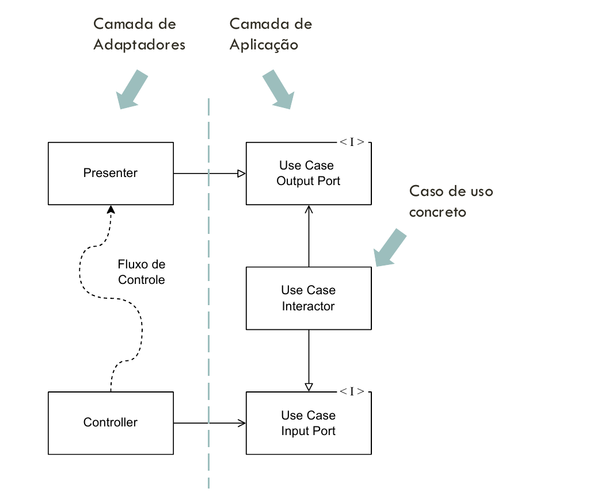

# Princípios de Design e Projetos Flexíveis

## 1. Visão geral da aula

Depois de modelar requisitos, interações e domínio, ainda é preciso decidir **como organizar o código para que mudanças futuras sejam compreensíveis e seguras**. A aula reúne princípios de design que ajudam a distribuir responsabilidades, evitar acoplamento desnecessário e separar regras de negócio de detalhes técnicos.

O percurso é:

1. **DRY, YAGNI e KISS:** reduzir duplicação e complexidade sem necessidade.
2. **SOLID:** projetar módulos coesos, extensíveis e substituíveis.
3. **Inversão e injeção de dependência:** fazer a lógica de negócio depender de contratos estáveis.
4. **Arquitetura Limpa:** aplicar essas decisões à organização do sistema.

Esses princípios são **critérios para tomar decisões**, não uma obrigação de criar interfaces ou camadas para toda classe. A pergunta prática é: *que mudança este desenho precisa acomodar e quanto custa mantê-lo?*

---

## 2. DRY — Don't Repeat Yourself

O princípio **DRY** procura evitar a repetição do mesmo **conhecimento** em vários lugares. Se uma regra de negócio aparece em três pontos, alterá-la exige lembrar de todos eles. Uma cópia esquecida pode produzir resultados inconsistentes.

Os slides distinguem três formas de duplicação:

| Forma | O que acontece | Exemplo |
| --- | --- | --- |
| Explícita | A mesma rotina ou informação aparece em vários pontos. | Duas classes calculam o mesmo desconto com a mesma regra. |
| Inadvertida | O modelo de dados força a repetição de uma informação. | Um comprimento é guardado apesar de poder ser calculado a partir das extremidades da linha. |
| Imposta | O processo ou o projeto exige manter cópias sincronizadas. | Documentação e código repetem manualmente uma lista de opções. |

### Exemplo da linha

No exemplo da aula, uma linha possui dois pontos. Guardar também seu comprimento cria um **estado derivado** que pode ficar desatualizado quando algum ponto muda:

```java
record Line(Point begin, Point end, double length) { }
```

Se `Point` oferece `distanceTo`, o comprimento pode ser calculado a partir da fonte de informação:

```java
record Line(Point begin, Point end) {
    double length() {
        return begin.distanceTo(end);
    }
}
```

Agora não há duas informações independentes que precisam concordar. Em um sistema real, calcular sempre pode ter custo; se o valor for armazenado por desempenho, é preciso definir claramente **quem o atualiza e como mantém a consistência**.

> [!important] Duas partes parecidas nem sempre violam DRY
> Dois trechos de código só representam a mesma duplicação quando expressam o **mesmo conhecimento** e tendem a mudar pelos **mesmos motivos**. Unir regras diferentes apenas porque a sintaxe se parece pode criar uma abstração difícil de entender.

---

## 3. YAGNI e KISS

### YAGNI — You Aren't Gonna Need It

**YAGNI** orienta a implementar uma capacidade quando existe uma necessidade concreta, em vez de construir antecipadamente possibilidades imaginadas.

Imagine um relatório que hoje só precisa ser salvo em arquivo CSV. Criar de antemão dezenas de formatos, mecanismos de plugins e configuração dinâmica aumenta o código que precisa ser entendido e testado. Quando surgir um segundo formato real, haverá informação suficiente para escolher uma extensão adequada.

YAGNI **não significa ignorar requisitos conhecidos**. Significa evitar trabalho baseado apenas na suposição de que algo poderá ser útil um dia.

### KISS — Keep It Simple, Stupid

**KISS** recomenda escolher a solução mais simples que atenda corretamente às necessidades atuais. Simplicidade envolve clareza, previsibilidade e facilidade de manutenção, não apenas poucas linhas de código.

Por exemplo, uma validação direta e legível costuma ser melhor que uma hierarquia de classes criada para uma regra que não varia. Mas, se a regra realmente possui várias implementações, uma abstração pode ser a solução mais simples **para aquele contexto**.

### Relação entre os três princípios

- **DRY:** evite múltiplas representações do mesmo conhecimento.
- **YAGNI:** não desenvolva capacidades sem demanda.
- **KISS:** resolva a demanda com a menor complexidade necessária.

Um excesso de abstrações pode surgir justamente de uma aplicação apressada de DRY: extrair uma interface genérica para dois códigos superficialmente parecidos talvez contrarie KISS e YAGNI.

---

## 4. SOLID: visão geral

**SOLID** reúne cinco princípios para orientar o design orientado a objetos. Eles não formam uma receita automática; ajudam a identificar onde uma decisão de projeto pode dificultar mudanças.

| Letra | Princípio | Pergunta de projeto |
| --- | --- | --- |
| **S** | Responsabilidade Única (*Single Responsibility*) | Que ator ou motivo exige mudanças neste módulo? |
| **O** | Aberto-Fechado (*Open/Closed*) | Uma nova variante exige alterar o núcleo existente? |
| **L** | Substituição de Liskov (*Liskov Substitution*) | Uma implementação pode substituir outra sem surpreender o cliente? |
| **I** | Segregação de Interfaces (*Interface Segregation*) | O cliente depende de operações que não usa? |
| **D** | Inversão de Dependência (*Dependency Inversion*) | A regra de negócio conhece detalhes concretos de infraestrutura? |

---

## 5. S — Princípio da Responsabilidade Única

Um módulo deve ter **uma razão para mudar**. Os slides associam essa razão a um **ator**: uma pessoa, grupo ou área que solicita mudanças no sistema.

Isso não significa que uma classe só possa ter um método. Uma classe pode ter várias operações relacionadas à mesma responsabilidade. O problema aparece quando motivos de mudança independentes ficam misturados.

### Exemplo: processamento de pedido

Uma primeira versão de `OrderService` processa o pedido, salva no banco e envia notificações. Assim, mudanças na persistência ou no canal de notificação podem exigir editar a mesma classe responsável pelo fluxo de pedidos.

```java
class OrderService {
    void processOrder(Order order) {
        // Lógica de processamento
        saveOrder(order);         // Detalhe de persistência
        sendNotification(order);  // Detalhe de comunicação
    }
}
```

Na refatoração apresentada na aula, o serviço **coordena** o caso de uso e delega as operações especializadas:

```java
class OrderService {
    private final OrderRepository orders;
    private final NotificationService notifications;

    OrderService(OrderRepository orders, NotificationService notifications) {
        this.orders = orders;
        this.notifications = notifications;
    }

    void processOrder(Order order) {
        orders.save(order);
        notifications.sendNotification(order);
    }
}
```

O serviço ainda possui uma responsabilidade: **orquestrar o processamento do pedido**. Salvar e notificar não desapareceram; foram atribuídos a componentes com razões de mudança distintas. Essa divisão também facilita testar o fluxo com implementações substitutas de `OrderRepository` e `NotificationService`.

> [!tip] Como reconhecer uma violação
> Pergunte quem pediria cada alteração. Se a equipe de persistência, a de comunicação e a responsável pelas regras de pedido precisam editar o mesmo módulo por razões independentes, pode haver responsabilidades misturadas.

---

## 6. O — Princípio Aberto-Fechado

Um módulo deve ser **aberto para extensão e fechado para modificação**. A intenção é acrescentar um comportamento sem alterar repetidamente o código estável que o utiliza.

### Exemplo: formas de pagamento

No exemplo da aula, um processador com `if/else` precisa ser alterado toda vez que um novo tipo de pagamento é acrescentado:

```java
void processPayment(String paymentType) {
    if (paymentType.equals("creditCard")) {
        processCreditCardPayment();
    } else if (paymentType.equals("paypal")) {
        processPayPalPayment();
    }
}
```

Se as formas de pagamento realmente variam, pode-se separar o contrato do comportamento concreto:

```java
interface PaymentMethod {
    void process();
}

class PaymentService {
    void processPayment(PaymentMethod method) {
        method.process();
    }
}

class CreditCardPaymentMethod implements PaymentMethod {
    public void process() { /* Pagamento com cartão */ }
}

class PayPalPaymentMethod implements PaymentMethod {
    public void process() { /* Pagamento com PayPal */ }
}
```

Uma nova implementação de `PaymentMethod` pode ser passada a `PaymentService` sem alterar seu método. **A escolha da implementação ainda precisa acontecer em algum lugar**, como na configuração ou na camada que recebe a requisição. O princípio protege o núcleo da lógica; não promete que nenhum arquivo do sistema jamais mudará.

### Quando vale a pena?

A abstração faz sentido quando existe uma variação real e o código cliente deve permanecer estável diante dela. Para uma única forma de pagamento sem sinais de extensão, antecipar uma hierarquia inteira pode contrariar YAGNI.

---

## 7. L — Princípio da Substituição de Liskov

Se um cliente espera um objeto do tipo base, deve poder receber uma implementação derivada **sem perder as garantias do contrato**. Substituição é uma propriedade do comportamento, não apenas da sintaxe de herança.

Uma subclasse não deve:

- exigir **pré-condições mais restritivas** do que a classe base;
- oferecer **pós-condições mais fracas** do que as prometidas;
- violar **invariantes** do objeto;
- introduzir exceções incompatíveis com o contrato esperado pelo cliente.

### Exemplo: média de notas

Nos slides, `AverageCalculator` aceita uma lista de notas no intervalo de `0` a `10` e devolve `0` para uma lista vazia. O resultado é uma média válida, também entre `0` e `10`.

Uma subclasse chamada `ExtraPointAverageCalculator` quebra essas expectativas: lança exceção para lista vazia, deixa de validar o intervalo e soma `1` à média, podendo devolver `11`.

```text
Contrato da classe base:
  []        -> 0
  [9, 10]   -> 9,5
  [11]      -> erro de entrada

Possível comportamento da subclasse dos slides:
  []        -> exceção inesperada
  [9, 10]   -> 10,5 (fora da faixa prometida)
  [11]      -> 12 (entrada inválida aceita)
```

Um cliente que usa `AverageCalculator` não deveria precisar perguntar qual subtipo recebeu antes de confiar no resultado.

> [!important] Atenção ao exemplo
> O ponto extra pode ser uma regra válida em outro domínio. O erro de design está em apresentá-lo como uma implementação substituível de **um contrato que promete outra coisa**. Uma operação com contrato próprio ou composição de regras pode representar melhor essa necessidade.

---

## 8. I — Princípio da Segregação de Interfaces

Clientes e implementações devem depender **das operações de que realmente precisam**. Uma interface grande pode forçar uma classe a expor métodos que ela não consegue cumprir coerentemente.

### Exemplo: repositório de transações

Os slides mostram um `GenericRepository` que exige registro, consulta, atualização e exclusão. Entretanto, um repositório de transações bancárias não deveria necessariamente permitir atualizar ou apagar transações. A implementação acaba oferecendo métodos que lançam `UnsupportedOperationException`.

```java
interface GenericRepository<T, K> {
    void register(T item);
    Optional<T> findBy(K key);
    List<T> findAll();
    void update(T item);
    void deleteBy(K key);
}
```

Se o contrato declara `deleteBy`, mas uma implementação sempre falha, o consumidor não pode confiar na interface. Isso aproxima o problema também de **Liskov**.

Uma alternativa é dividir os contratos por capacidade:

```java
interface RegistrableRepository<T> {
    void register(T item);
}

interface ReadableRepository<T, K> {
    Optional<T> findBy(K key);
    List<T> findAll();
}

interface UpdatableRepository<T> {
    void update(T item);
}

interface DeletableRepository<K> {
    void deleteBy(K key);
}

interface BankTransactionRepository
        extends RegistrableRepository<Transaction>,
                ReadableRepository<Transaction, UUID> { }
```

Agora o contrato de transações expressa apenas **registro e leitura**. Outras implementações podem combinar capacidades diferentes. Interfaces menores também limitam o impacto de uma alteração: um cliente que só lê não precisa conhecer operações de exclusão.

---

## 9. D — Princípio da Inversão de Dependência

Regras de negócio de alto nível não devem depender diretamente de classes concretas que lidam com detalhes técnicos, como arquivos, banco de dados, serviços externos e interface de usuário. **Ambos os lados devem depender de abstrações adequadas ao caso de uso.**



*Figura da aula: à esquerda, `BusinessLogic` depende de `LowLevelClass`; à direita, a lógica conhece uma interface, e a classe concreta a implementa.*

### Por que isso dá estabilidade?

Classes de infraestrutura tendem a mudar quando trocamos uma biblioteca, banco, formato de arquivo ou provedor externo. Se a regra de negócio conhece diretamente essas classes, cada troca pode atravessar o núcleo da aplicação.

Com uma interface voltada à necessidade da regra, a implementação técnica pode ser substituída. A abstração também precisa ser **estável e bem definida**; criar uma interface que apenas copia cada método da biblioteca concreta não reduz muito o acoplamento.

Os slides recomendam, entre outras práticas:

- declarar atributos e parâmetros pelo tipo abstrato quando isso expressa o contrato necessário;
- concentrar a escolha das implementações concretas na composição da aplicação;
- evitar que classes de domínio importem diretamente detalhes de persistência e serviços externos;
- preferir composição a herdar de classes concretas voláteis.

### Inversão de dependência × injeção de dependência

**Inversão de dependência** é a regra de organização: o núcleo depende de contratos, e os detalhes implementam esses contratos. **Injeção de dependência** é uma forma de fornecer ao objeto as implementações que ele usará, por exemplo pelo construtor. Injetar uma classe concreta sem criar um contrato adequado **não garante**, por si só, a inversão.

---

## 10. Exemplo completo: serviço de relatórios

O exemplo dos slides usa um serviço que formata dados de funcionários e exporta o conteúdo. Formatação e destino são **detalhes substituíveis**; o fluxo central é produzir e exportar o relatório.

### 10.1 Contratos necessários ao serviço

```java
interface EmployeeFormatter {
    String format(Employee[] employees);
}

interface Exporter {
    void export(String content, String destination);
}
```

O serviço recebe esses contratos pelo construtor:

```java
class EmployeeReportService {
    private final EmployeeFormatter formatter;
    private final Exporter exporter;

    EmployeeReportService(EmployeeFormatter formatter, Exporter exporter) {
        this.formatter = formatter;
        this.exporter = exporter;
    }

    void createReport(Employee[] employees, String destination) {
        String content = formatter.format(employees);
        exporter.export(content, destination);
    }
}
```

`EmployeeReportService` não sabe se o conteúdo é CSV, JSON ou texto, nem se será escrito em arquivo ou exibido no console. Ele conhece apenas as operações de que precisa.

### 10.2 Implementações concretas

No material, `CsvEmployeeFormatter` produz linhas CSV e `FileExporter` grava o texto em um arquivo. O exemplo simplificado abaixo destaca a separação das responsabilidades:

```java
class CsvEmployeeFormatter implements EmployeeFormatter {
    public String format(Employee[] employees) {
        StringJoiner lines = new StringJoiner("\n");
        for (Employee employee : employees) {
            lines.add(employee.getName() + "," + employee.getDateOfEmployment());
        }
        return lines.toString();
    }
}

class FileExporter implements Exporter {
    public void export(String content, String destination) {
        // Grava o conteúdo no arquivo indicado.
    }
}

class ConsoleExporter implements Exporter {
    public void export(String content, String destination) {
        System.out.println(content);
    }
}
```

O trecho de CSV ilustra a responsabilidade do formatador. Em uma implementação de produção seria necessário **escapar separadores, aspas e quebras de linha** presentes nos dados.

### 10.3 Composição da aplicação

Quem inicia a aplicação escolhe as implementações e as injeta no serviço:

```java
EmployeeFormatter formatter = new CsvEmployeeFormatter();
Exporter exporter = new FileExporter();

EmployeeReportService service = new EmployeeReportService(formatter, exporter);
service.createReport(employees, "legends.csv");
```

Para exibir o relatório, a composição troca apenas o exportador:

```java
Exporter exporter = new ConsoleExporter();
EmployeeReportService service = new EmployeeReportService(formatter, exporter);
service.createReport(employees, null);
```

`null` aparece aqui porque a assinatura do exemplo dos slides mantém `destination` mesmo quando o console não o utiliza. Em um projeto real, convém rever esse contrato se tal parâmetro não fizer sentido para todos os exportadores.

**O que mudou?** A classe de alto nível permaneceu a mesma. O formato e o destino são escolhidos fora dela. Isso combina **OCP** (extensão por novas implementações) e **DIP** (dependência de abstrações).

---

## 11. Dos princípios à arquitetura

Os slides citam **Arquitetura Cebola**, **Arquitetura Hexagonal (Portas e Adaptadores)** e **Arquitetura Limpa** como estilos que separam regras de negócio dos detalhes externos por meio de dependências indiretas.

Eles não são idênticos, mas compartilham a preocupação de manter o **núcleo do negócio independente de infraestrutura**. Nesta aula, a Arquitetura Limpa recebe o detalhamento maior.

Essa ideia se conecta à nota de [[APOO/Aula8/DDD|DDD]]: entidades e regras de domínio devem representar o negócio; repositórios, interface de usuário e banco de dados são mecanismos usados pela aplicação.

---

## 12. Arquitetura Limpa

A Arquitetura Limpa organiza o sistema em camadas com diferentes responsabilidades. No diagrama dos slides, as **setas apontam para dentro**: as dependências de código das camadas externas apontam para conceitos mais internos.



*Figura da aula: as regras de negócio da empresa ficam no centro; banco, interface e dispositivos ocupam a borda externa.*

| Camada | Responsabilidade | Exemplos |
| --- | --- | --- |
| **Regras de negócio** | Representar conceitos e invariantes do domínio. | Entidades, objetos de valor. |
| **Regras da aplicação** | Executar casos de uso e coordenar objetos do domínio. | Registrar pedido, aprovar matrícula. |
| **Adaptadores de interface** | Traduzir dados entre o núcleo e os mecanismos externos. | Controller, presenter, gateway. |
| **Frameworks e drivers** | Hospedar ou executar detalhes técnicos. | Banco de dados, UI, framework web. |

### 12.1 Direção das dependências

Uma entidade do domínio não deve importar uma classe do framework web nem depender de uma implementação específica de banco. O código externo pode conhecer o núcleo; o núcleo define contratos que a parte externa implementa.

Uma regra simples para ler o desenho: **o lugar onde o programa executa não determina a direção da dependência de código**. Uma chamada pode sair de um caso de uso rumo à persistência, enquanto a implementação do repositório depende de uma interface definida no lado interno.

### 12.2 Portas, controllers e presenters

Os slides mostram um caso de uso concreto (`Use Case Interactor`) ligado a portas de entrada e saída. O `Controller` recebe uma interação externa e chama a **porta de entrada**. O caso de uso coordena o trabalho e comunica o resultado por uma **porta de saída**, implementada por um `Presenter`.



*Figura da aula: o fluxo de controle passa pelo caso de uso, mas as interfaces permitem que as dependências de código permaneçam voltadas para a camada interna.*

Um caminho possível é:

```text
Interface / requisição
    -> Controller
    -> Porta de entrada
    -> Caso de uso
    -> Entidades e porta de persistência
    -> Porta de saída
    -> Presenter
    -> Resposta / visualização
```

**Porta** é o contrato; **adaptador** é o código que conecta esse contrato a um mecanismo externo. O controller traduz a entrada, e o presenter traduz a saída para uma forma adequada à interface. Assim, o caso de uso não precisa conhecer detalhes de HTTP, tela ou console.

### 12.3 Cuidados na aplicação

- A camada interna não deve depender de frameworks ou de modelos específicos de transporte.
- Objetos de camadas diferentes se comunicam por contratos definidos conforme a necessidade do caso de uso.
- A divisão em camadas deve tornar o sistema mais claro; para um programa pequeno, criar muitas estruturas vazias pode contrariar KISS e YAGNI.

---

## 13. Como os princípios se combinam

Considere o caso de uso **registrar um pedido**:

1. A entidade `Pedido` protege suas invariantes. Suas regras não são copiadas no controller (**DRY**).
2. O serviço de aplicação coordena o registro, enquanto repositório e notificação têm responsabilidades próprias (**SRP**).
3. O caso de uso recebe interfaces específicas, como `PedidoRepository`, sem operações que não utiliza (**ISP**).
4. Um repositório em memória ou SQL pode implementar o mesmo contrato sem quebrar o comportamento esperado (**LSP**).
5. O caso de uso depende da interface e recebe uma implementação por injeção (**DIP**).
6. Uma nova estratégia de persistência não exige alterar a regra do caso de uso (**OCP**).
7. Só se cria a variação quando ela passa a ser necessária, com a estrutura mais simples que a suporte (**YAGNI** e **KISS**).

O resultado desejado não é “usar todos os padrões”, mas **conter o impacto de uma mudança no lugar correto**.

---

## 14. Exercício proposto nos slides

O exercício pede escolher um dos agregados identificados na atividade de DDD e construir uma estrutura de Arquitetura Limpa. Uma forma de organizar a entrega é:

1. Modelar as **classes e relações do agregado**, indicando a raiz e as invariantes.
2. Definir uma **porta de entrada** para o caso de uso que registra o agregado.
3. Criar modelos de **entrada e saída** para esse caso de uso.
4. Definir uma **porta de saída (presenter)** para resultados de sucesso e falha.
5. Definir uma interface de **repositório** para persistir o agregado.
6. Implementar o caso de uso recebendo presenter e repositório por **injeção de dependência**.
7. Implementar um presenter que imprime o resultado no console.
8. Implementar o repositório com um `Map` em memória.
9. Criar uma classe principal que atua como composição/controlador e conecta as implementações.

Para conferir o desenho, pergunte: **o caso de uso poderia continuar igual se o `Map` fosse substituído por um banco de dados?** E se o console fosse substituído por uma interface web? Se a resposta exigir editar as regras do caso de uso, revise a direção das dependências.

---

## 15. Resumo para revisão

| Princípio | Ideia central | Sinal de alerta |
| --- | --- | --- |
| DRY | Uma fonte para cada conhecimento. | A mesma regra precisa ser atualizada em vários lugares. |
| YAGNI | Implementar quando houver demanda real. | Código complexo para cenários hipotéticos. |
| KISS | Preferir a solução suficiente mais simples. | Estrutura difícil de explicar sem necessidade concreta. |
| SRP | Um módulo, uma razão de mudança. | Atores diferentes alteram a mesma classe por razões independentes. |
| OCP | Estender comportamento preservando o núcleo. | Cada nova variante exige editar um grande `if/else` estável. |
| LSP | Implementações honram o contrato. | Uma subclasse surpreende o cliente com exceções ou resultados inválidos. |
| ISP | Contratos focados no cliente. | Métodos sem sentido são implementados só para cumprir a interface. |
| DIP | Regras dependem de abstrações. | Uma troca de banco ou formato altera diretamente o caso de uso. |

**Arquitetura Limpa:** regras no centro; adaptação e infraestrutura nas bordas; dependências de código voltadas ao interior.

### Fonte da aula

Nota elaborada a partir dos slides **“Princípios de Design e Projetos Flexíveis”**, de **Prof. Dr. Lucas Bueno R. Oliveira**, APOO, IFSP Câmpus São Carlos. Os exemplos de código foram resumidos ou adaptados para explicar as ideias; as três figuras foram extraídas dos slides 23, 33 e 34.
