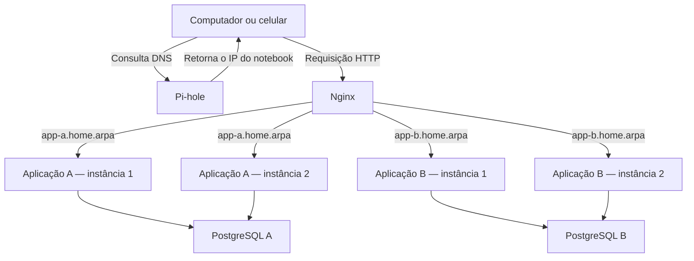

# note-testes

## Objetivo do laboratório

A ideia é aproveitar um notebook Linux como laboratório sem perder sua função de computador pessoal e máquina de emergência.

O sistema continua sendo o Fedora com KDE. Docker recebe as aplicações e os serviços de infraestrutura. KVM executa uma VM separada para os downloads.

O laboratório permite estudar DNS, proxy reverso, balanceamento, persistência, isolamento, falhas e recuperação.

> [!note] Estado do roteiro
> Esta nota registra os testes que pretendo fazer no notebook homelab. A implantação ainda não foi executada no notebook; os resultados descritos são os esperados para conferir durante os experimentos.

Todos os componentes continuam dependendo do mesmo computador. Portanto, conseguimos simular falhas de processos e serviços, mas uma falha física do notebook interrompe tudo.

## 1. Definir a arquitetura e a responsabilidade de cada componente

O ambiente terá duas aplicações lógicas:

- **Aplicação A:** duas instâncias compartilhando o banco A.
- **Aplicação B:** duas instâncias compartilhando o banco B.

O Nginx escolhe a aplicação pelo nome solicitado e distribui as requisições entre suas instâncias.



O Pi-hole participa da descoberta do endereço. Depois que o cliente conhece o IP, a conexão HTTP segue diretamente para o Nginx.

**O Nginx não gerencia os bancos.** Cada aplicação estabelece suas próprias conexões com seu PostgreSQL.

Também é importante separar:

| Situação | Significado |
| --- | --- |
| Duas instâncias da aplicação A usando o banco A | Réplicas da aplicação compartilhando estado |
| Aplicação A usando banco A e aplicação B usando banco B | Aplicações com dados separados |
| Dois PostgreSQL recebendo gravações sobre os mesmos dados | Exige uma arquitetura de replicação e consistência |

Distribuir conexões aleatoriamente entre bancos independentes pode produzir dados diferentes em cada um. A documentação do PostgreSQL explica por que distribuir leituras e distribuir gravações são problemas distintos. [PostgreSQL: disponibilidade, balanceamento e replicação](https://www.postgresql.org/docs/current/high-availability.html).

A VM de downloads fica em outro caminho:


## 2. Preparar uma pasta de trabalho e definir os endereços de exemplo

Neste roteiro:

| Recurso | Endereço de exemplo |
| --- | --- |
| Rede doméstica | `192.168.0.0/24` |
| IP reservado do notebook pelo cabo | `192.168.0.50` |
| Interface cabeada | `enp7s0f1` |
| Rede da VM de downloads | `192.168.250.0/24` |
| Gateway virtual da VM | `192.168.250.1` |
| VM de downloads | `192.168.250.10` |

**Esses endereços precisam ser adaptados à rede real.** O endereço doméstico deve estar reservado para o MAC da interface cabeada. A rede virtual não pode coincidir com outra rede física, VPN ou rede Docker.

No Fedora, conferir:

```bash
ip -br address
ip route
docker network ls
virsh -c qemu:///system net-list --all
```

Instalar as ferramentas necessárias:

```bash
sudo dnf install virt-manager nftables policycoreutils-python-utils bind-utils openssl
```

Docker, Compose e a base de virtualização já estão instalados neste notebook.

Criar a estrutura:

```bash
mkdir -p ~/homelab/{app,nginx,sql,backups}
cd ~/homelab
```

Ela ficará assim:

```text
homelab/
├── .env
├── .gitignore
├── compose.dns.yaml
├── compose.apps.yaml
├── homelab.nft
├── vm-downloads.xml
├── app/
│   ├── package.json
│   ├── Dockerfile
│   └── server.mjs
├── nginx/
│   └── default.conf
├── sql/
│   └── init.sh
└── backups/
```

Começar com os serviços publicados **somente no próprio notebook**:

```bash
umask 077

{
  printf 'LAB_IP=127.0.0.1\n'
  for chave in DB_A_ADMIN_PASSWORD DB_A_PASSWORD DB_B_ADMIN_PASSWORD DB_B_PASSWORD PIHOLE_PASSWORD
  do
    printf '%s=%s\n' "$chave" "$(openssl rand -hex 24)"
  done
} > .env
```

Esse comando deve ser usado na criação inicial. Executá-lo novamente substitui as senhas do arquivo.

Criar `.gitignore`:

```gitignore
.env
backups/
node_modules/
```

As configurações podem ser documentadas ou versionadas. O `.env` real e os backups contêm informações que não devem acompanhar a publicação da nota.

Para encurtar os próximos comandos, definir duas funções no terminal:

```bash
lab_apps() {
  docker compose \
    --project-directory "$HOME/homelab" \
    --env-file "$HOME/homelab/.env" \
    -p lab-apps \
    -f "$HOME/homelab/compose.apps.yaml" "$@"
}

lab_dns() {
  docker compose \
    --project-directory "$HOME/homelab" \
    --env-file "$HOME/homelab/.env" \
    -p lab-dns \
    -f "$HOME/homelab/compose.dns.yaml" "$@"
}
```

Elas valem para aquela sessão do terminal.

## 3. Preparar as regras de rede antes de disponibilizar o laboratório na LAN ou iniciar a VM

Existem dois controles diferentes:

- Restringir quem consegue acessar as portas publicadas pelo laboratório.
- Impedir que a VM de downloads inicie conexões contra o host e redes internas.

O Docker cria suas próprias regras de encaminhamento. Uma porta publicada por ele não deve ser considerada protegida apenas porque uma zona do `firewalld` não libera aquela porta. [Docker: filtragem de pacotes e firewalls](https://docs.docker.com/engine/network/packet-filtering-firewalls/).

O arquivo abaixo adiciona tabelas próprias de nftables, preservando as tabelas existentes do Docker, libvirt e firewalld.

Salvar como `~/homelab/homelab.nft`, **ajustando IP, sub-rede e interface domésticos**:

```nft
destroy table inet homelab_ingress
destroy table inet download_guard

table inet homelab_ingress {
  chain entrada_publicada {
    type filter hook prerouting priority -110; policy accept;

    ip daddr 192.168.0.50 tcp dport { 53, 80 } iifname "enp7s0f1" ip saddr 192.168.0.0/24 counter accept
    ip daddr 192.168.0.50 udp dport 53 iifname "enp7s0f1" ip saddr 192.168.0.0/24 counter accept

    ip daddr 192.168.0.50 tcp dport { 53, 80 } counter drop
    ip daddr 192.168.0.50 udp dport 53 counter drop
  }
}

table inet download_guard {
  set internos_v4 {
    type ipv4_addr
    flags interval
    elements = {
      0.0.0.0/8,
      10.0.0.0/8,
      100.64.0.0/10,
      127.0.0.0/8,
      169.254.0.0/16,
      172.16.0.0/12,
      192.168.0.0/16,
      224.0.0.0/4,
      240.0.0.0/4
    }
  }

  chain entrada_host {
    type filter hook input priority -10; policy accept;

    iifname "virbr-dl" ct state established,related accept

    iifname "virbr-dl" ip protocol udp udp sport 68 udp dport 67 accept
    iifname "virbr-dl" ip daddr 192.168.250.1 udp dport 53 accept
    iifname "virbr-dl" ip daddr 192.168.250.1 tcp dport 53 accept

    iifname "virbr-dl" counter drop
  }

  chain encaminhamento {
    type filter hook forward priority -10; policy accept;

    iifname "virbr-dl" meta nfproto ipv6 counter drop
    iifname "virbr-dl" ip daddr @internos_v4 counter drop

    oifname "virbr-dl" ct state established,related accept
    oifname "virbr-dl" counter drop
  }
}
```

O resultado pretendido é:

| Comunicação | Comportamento |
| --- | --- |
| LAN doméstica pelo cabo → DNS e HTTP do laboratório | Permitida |
| Outras interfaces → essas portas no IP doméstico | Bloqueada |
| VM → internet IPv4 | Permitida pelas regras normais de NAT |
| VM → intervalos internos listados | Bloqueada |
| VM → serviços do Fedora | Bloqueada, com exceção do DHCP e DNS necessários |
| Fedora → VM | Pode iniciar conexões |
| Resposta da VM a uma conexão iniciada pelo Fedora | Permitida |
| Encaminhamento IPv6 da VM | Bloqueado neste roteiro |

Os intervalos cobrem redes internas comuns. Redes internas com outros prefixos precisam ser acrescentadas. A regra também não identifica, por si só, que determinado cabo pertence à sua casa: o laboratório deve ser parado antes de sair dela.

A operação `destroy` permite substituir essas tabelas mesmo quando ainda não existem. O carregamento do arquivo é transacional. **Não usar `flush ruleset`**, pois isso removeria regras administradas por outros serviços. [Manual do nftables](https://netfilter.org/projects/nftables/manpage.html).

Instalar o arquivo:

```bash
sudo install -d /etc/nftables
sudo install -m 600 ~/homelab/homelab.nft /etc/nftables/homelab.nft
sudo nft -c -f /etc/nftables/homelab.nft
```

O comando com `-c` verifica a configuração sem aplicá-la.

Criar `/etc/systemd/system/homelab-firewall.service`:

```ini
[Unit]
Description=Regras de rede do homelab
After=firewalld.service
Before=docker.service libvirtd.service virtqemud.service virtnetworkd.service

[Service]
Type=oneshot
ExecStart=/usr/sbin/nft -f /etc/nftables/homelab.nft
RemainAfterExit=yes

[Install]
WantedBy=multi-user.target
```

Ativar:

```bash
sudo systemctl daemon-reload
sudo systemctl enable --now homelab-firewall.service
```

Conferir:

```bash
systemctl status homelab-firewall.service --no-pager
sudo nft list table inet homelab_ingress
sudo nft list table inet download_guard
```

Só avançar para a exposição na LAN ou para o uso da VM depois que as regras estiverem carregadas. Repetir essa conferência após reiniciar o computador.

## 4. Subir o Pi-hole inicialmente apenas para testes locais

Criar `compose.dns.yaml`:

```yaml
services:
  pihole:
    image: pihole/pihole:latest
    restart: "no"
    mem_limit: 256m
    cpus: 0.5

    ports:
      - "${LAB_IP:?}:53:53/tcp"
      - "${LAB_IP:?}:53:53/udp"
      - "127.0.0.1:8081:80"

    environment:
      TZ: America/Sao_Paulo
      FTLCONF_webserver_api_password: ${PIHOLE_PASSWORD:?}
      FTLCONF_dns_listeningMode: ALL
      FTLCONF_dns_upstreams: "9.9.9.9;149.112.112.112"

    volumes:
      - pihole:/etc/pihole

volumes:
  pihole:
```

O exemplo usa o modo de escuta indicado para a rede bridge do Docker. As portas publicadas e as regras externas limitam de onde chegam as consultas. Como o roteador continuará fornecendo DHCP, não foi adicionada a capacidade `NET_ADMIN`. [Pi-hole em Docker](https://docs.pi-hole.net/docker/).

Iniciar e conferir:

```bash
lab_dns config -q
lab_dns up -d
lab_dns logs --tail=50
```

Com `LAB_IP=127.0.0.1`, testar:

```bash
dig @127.0.0.1 example.com
dig +tcp @127.0.0.1 example.com
```

O primeiro comando testa uma consulta normalmente transportada por UDP; o segundo força TCP. DNS precisa dos dois.

O painel fica em:

```text
http://127.0.0.1:8081/admin/
```

A senha está no `.env`.

A porta do painel permanece vinculada ao loopback mesmo quando o DNS passar a atender a LAN.

O `systemd-resolved` encontrado neste notebook escuta em `127.0.0.53` e `127.0.0.54`. Publicar em um endereço específico evita tentar ocupar indiscriminadamente todos os endereços da porta 53. Antes de subir, conferir os listeners:

```bash
sudo ss -lntup
```

Se houver conflito, identificar o endereço e o processo antes de alterar o resolvedor do Fedora.

**“DNS privado” aqui significa um serviço sob seu controle.** Este exemplo consulta os upstreams por DNS tradicional; não configura automaticamente DNS criptografado nem oculta todo o tráfego da rede.

## 5. Criar uma aplicação pequena para observar o balanceamento e a persistência

A aplicação terá três operações:

| Requisição | Resultado |
| --- | --- |
| `GET /health` | Verifica a conexão com o banco |
| `GET /` ou `GET /contador` | Retorna instância, banco e contador |
| `POST /contador` | Incrementa o contador no PostgreSQL |

O contador fica no banco. Assim, trocar a instância que atendeu a requisição não faz o estado desaparecer.

Criar `app/package.json`:

```json
{
  "private": true,
  "type": "module",
  "dependencies": {
    "pg": "8.16.3"
  }
}
```

Criar `app/server.mjs`:

```javascript
import http from 'node:http';
import pg from 'pg';

const instancia = process.env.INSTANCE_ID;

const pool = new pg.Pool({
  max: 3,
  connectionTimeoutMillis: 2000,
  idleTimeoutMillis: 10000,
  statement_timeout: 3000,
});

pool.on('error', (erro) => console.error(erro.message));

const server = http.createServer(async (req, res) => {
  const responder = (status, dados) => {
    res.writeHead(status, {
      'Content-Type': 'application/json; charset=utf-8',
      'Cache-Control': 'no-store',
    });

    res.end(JSON.stringify(dados) + '\n');
  };

  try {
    const caminho = new URL(req.url, 'http://localhost').pathname;

    if (req.method === 'GET' && caminho === '/health') {
      await pool.query('SELECT 1');
      return responder(200, { ok: true, instancia });
    }

    let consulta;

    if (req.method === 'GET' && ['/', '/contador'].includes(caminho)) {
      consulta = `
        SELECT valor, current_database() AS banco
        FROM contador
        WHERE id = 1
      `;
    } else if (req.method === 'POST' && caminho === '/contador') {
      consulta = `
        UPDATE contador
        SET valor = valor + 1
        WHERE id = 1
        RETURNING valor, current_database() AS banco
      `;
    } else {
      return responder(404, { erro: 'Rota inexistente' });
    }

    const { rows } = await pool.query(consulta);
    responder(200, { instancia, ...rows[0] });
  } catch (erro) {
    console.error(erro.message);
    responder(503, { erro: 'Banco indisponível', instancia });
  }
});

server.listen(3000, '0.0.0.0');

process.on('SIGTERM', () => {
  server.close(async () => {
    await pool.end();
    process.exit(0);
  });

  setTimeout(() => process.exit(1), 8000).unref();
});
```

O `Pool` reutiliza conexões em vez de abrir uma conexão nova a cada requisição. Com duas instâncias e limite de três conexões em cada uma, cada aplicação poderá manter até seis conexões nos pools. [Documentação do node-postgres](https://node-postgres.com/features/pooling).

O incremento é feito por uma única instrução SQL. Não existe um ciclo na aplicação de “ler o valor, somar e gravar”, que poderia perder incrementos sob concorrência.

Criar `app/Dockerfile`:

```dockerfile
FROM node:24-alpine

WORKDIR /app

COPY package.json ./
RUN npm install --omit=dev --ignore-scripts

COPY server.mjs ./

USER node

EXPOSE 3000

CMD ["node", "server.mjs"]
```

A mesma imagem será usada pelas quatro instâncias. O que muda são as variáveis de ambiente.

## 6. Preparar bancos separados e uma credencial limitada para as aplicações

Cada PostgreSQL terá seu próprio volume.

As aplicações usarão o usuário `app`, com permissão para consultar e atualizar a tabela do exemplo. A senha administrativa fica apenas nos containers dos bancos.

Criar `sql/init.sh`:

```sh
#!/bin/sh
set -eu

psql -v ON_ERROR_STOP=1 \
  --username "$POSTGRES_USER" \
  --dbname "$POSTGRES_DB" \
  --set=app_password="$APP_PASSWORD" \
  --set=db_name="$POSTGRES_DB" <<'SQL'

CREATE ROLE app LOGIN PASSWORD :'app_password';

CREATE TABLE contador (
  id SMALLINT PRIMARY KEY CHECK (id = 1),
  valor BIGINT NOT NULL DEFAULT 0
);

INSERT INTO contador (id, valor) VALUES (1, 0);

GRANT CONNECT ON DATABASE :"db_name" TO app;
GRANT USAGE ON SCHEMA public TO app;
GRANT SELECT, UPDATE ON contador TO app;

SQL
```

Dar permissão de execução:

```bash
chmod +x sql/init.sh
```

Os scripts de inicialização da imagem PostgreSQL são executados quando o diretório de dados está vazio. Alterar esse script depois não modifica automaticamente bancos já inicializados. O mesmo vale para trocar senhas no `.env`: bancos existentes precisam de uma alteração explícita da credencial. [Imagem oficial do PostgreSQL](https://hub.docker.com/_/postgres).

Criar `compose.apps.yaml`:

```yaml
x-app: &app
  build: ./app
  image: homelab-api:local
  init: true
  restart: "no"
  read_only: true
  tmpfs: [/tmp]
  cap_drop: [ALL]
  security_opt: [no-new-privileges:true]
  mem_limit: 192m
  cpus: 0.5

  healthcheck:
    test:
      - CMD
      - node
      - -e
      - "fetch('http://127.0.0.1:3000/health').then(r=>process.exit(r.ok?0:1)).catch(()=>process.exit(1))"
    interval: 10s
    timeout: 5s
    retries: 10

x-db: &db
  image: postgres:17-alpine
  restart: "no"
  command:
    - postgres
    - -c
    - shared_buffers=64MB
    - -c
    - max_connections=40
  mem_limit: 384m
  cpus: 0.5

  healthcheck:
    test:
      - CMD-SHELL
      - 'pg_isready -h 127.0.0.1 -U postgres -d "$$POSTGRES_DB"'
    interval: 5s
    timeout: 3s
    retries: 20

services:
  db-a:
    <<: *db
    environment:
      POSTGRES_USER: postgres
      POSTGRES_DB: app_a
      POSTGRES_PASSWORD: ${DB_A_ADMIN_PASSWORD:?}
      APP_PASSWORD: ${DB_A_PASSWORD:?}
    volumes:
      - db_a:/var/lib/postgresql/data
      - ./sql/init.sh:/docker-entrypoint-initdb.d/01-init.sh:ro,z
    networks: [dados_a]

  db-b:
    <<: *db
    environment:
      POSTGRES_USER: postgres
      POSTGRES_DB: app_b
      POSTGRES_PASSWORD: ${DB_B_ADMIN_PASSWORD:?}
      APP_PASSWORD: ${DB_B_PASSWORD:?}
    volumes:
      - db_b:/var/lib/postgresql/data
      - ./sql/init.sh:/docker-entrypoint-initdb.d/01-init.sh:ro,z
    networks: [dados_b]

  app-a1:
    <<: *app
    environment: &env_a
      INSTANCE_ID: app-a1
      PGHOST: db-a
      PGDATABASE: app_a
      PGUSER: app
      PGPASSWORD: ${DB_A_PASSWORD:?}
    depends_on:
      db-a:
        condition: service_healthy
    networks: [frente_a, dados_a]

  app-a2:
    <<: *app
    environment:
      <<: *env_a
      INSTANCE_ID: app-a2
    depends_on:
      db-a:
        condition: service_healthy
    networks: [frente_a, dados_a]

  app-b1:
    <<: *app
    environment: &env_b
      INSTANCE_ID: app-b1
      PGHOST: db-b
      PGDATABASE: app_b
      PGUSER: app
      PGPASSWORD: ${DB_B_PASSWORD:?}
    depends_on:
      db-b:
        condition: service_healthy
    networks: [frente_b, dados_b]

  app-b2:
    <<: *app
    environment:
      <<: *env_b
      INSTANCE_ID: app-b2
    depends_on:
      db-b:
        condition: service_healthy
    networks: [frente_b, dados_b]

  nginx:
    image: nginx:stable-alpine
    restart: "no"
    mem_limit: 128m
    cpus: 0.5

    ports:
      - "${LAB_IP:?}:80:80"

    volumes:
      - ./nginx/default.conf:/etc/nginx/conf.d/default.conf:ro,Z

    depends_on:
      app-a1:
        condition: service_healthy
      app-a2:
        condition: service_healthy
      app-b1:
        condition: service_healthy
      app-b2:
        condition: service_healthy

    networks: [frente_a, frente_b]

volumes:
  db_a:
  db_b:

networks:
  frente_a:
  frente_b:

  dados_a:
    internal: true

  dados_b:
    internal: true
```

As redes fazem parte do desenho:

| Rede | Participantes |
| --- | --- |
| `frente_a` | Nginx e instâncias A |
| `frente_b` | Nginx e instâncias B |
| `dados_a` | Instâncias A e banco A |
| `dados_b` | Instâncias B e banco B |

Os bancos não publicam `5432` no host. Cada um continua usando a porta `5432` dentro de seu próprio container, sem conflito.

As opções `z` e `Z` nas montagens cuidam da rotulagem SELinux: o script SQL é compartilhado entre dois containers; a configuração do Nginx tem uso exclusivo.

O `depends_on` com `service_healthy` aguarda a prontidão definida pelo healthcheck na inicialização. Ele não transforma o Compose em um sistema que recupera automaticamente todas as falhas posteriores. [Ordem de inicialização no Compose](https://docs.docker.com/compose/how-tos/startup-order/).

## 7. Configurar o Nginx para escolher a aplicação e distribuir suas requisições

Criar `nginx/default.conf`:

```nginx
resolver 127.0.0.11 valid=5s ipv6=off;

upstream app_a {
    zone app_a 64k;

    server app-a1:3000 resolve max_fails=1 fail_timeout=5s;
    server app-a2:3000 resolve max_fails=1 fail_timeout=5s;
}

upstream app_b {
    zone app_b 64k;

    server app-b1:3000 resolve max_fails=1 fail_timeout=5s;
    server app-b2:3000 resolve max_fails=1 fail_timeout=5s;
}

proxy_http_version 1.1;
proxy_set_header Host $host;
proxy_set_header X-Real-IP $remote_addr;
proxy_set_header X-Forwarded-For $proxy_add_x_forwarded_for;
proxy_set_header X-Forwarded-Proto $scheme;

proxy_connect_timeout 2s;
proxy_read_timeout 10s;

proxy_next_upstream error timeout http_502 http_503 http_504;
proxy_next_upstream_tries 2;

server {
    listen 80 default_server;
    server_name _;
    return 404;
}

server {
    listen 80;
    server_name app-a.home.arpa;

    location / {
        proxy_pass http://app_a;
    }
}

server {
    listen 80;
    server_name app-b.home.arpa;

    location / {
        proxy_pass http://app_b;
    }
}
```

O nome recebido no cabeçalho HTTP `Host` seleciona o bloco `server`. O `proxy_pass` aponta para o grupo de instâncias correspondente.

Sem outra estratégia configurada, o balanceamento usa round-robin. [Nginx como balanceador HTTP](https://nginx.org/en/docs/http/load_balancing.html).

O resolvedor `127.0.0.11` é o DNS interno disponibilizado pelo Docker nessas redes. O parâmetro `resolve` permite acompanhar mudanças nos endereços dos containers. Essa funcionalidade está disponível no Nginx aberto a partir da versão 1.27.3. [Módulo upstream](https://nginx.org/en/docs/http/ngx_http_upstream_module.html).

A configuração também permite tentar outro upstream em determinadas falhas. Isso exige cuidado com operações de gravação: uma resposta perdida não prova que uma gravação deixou de acontecer. APIs reais devem considerar chaves de idempotência e a semântica dos retries. [Módulo de proxy HTTP](https://nginx.org/en/docs/http/ngx_http_proxy_module.html).

## 8. Subir as aplicações e observar o comportamento

Ainda com `LAB_IP=127.0.0.1`:

```bash
lab_apps config -q
lab_apps build app-a1
lab_apps up -d --no-build
lab_apps ps
```

A imagem construída será compartilhada pelas quatro instâncias.

Conferir a configuração do proxy:

```bash
lab_apps exec nginx nginx -t
```

Testar sem depender do DNS:

```bash
curl --resolve app-a.home.arpa:80:127.0.0.1 \
  http://app-a.home.arpa/
```

Uma resposta possível:

```json
{"instancia":"app-a1","valor":"0","banco":"app_a"}
```

O `BIGINT` aparece como texto porque esse é o comportamento padrão do driver para evitar perda de precisão em números grandes.

Repetir:

```bash
for tentativa in $(seq 1 12)
do
  curl -s --resolve app-a.home.arpa:80:127.0.0.1 \
    http://app-a.home.arpa/
done
```

Devem aparecer respostas de `app-a1` e `app-a2`. Não é necessário observar uma alternância perfeita a cada linha.

Incrementar o contador A:

```bash
curl -X POST \
  --resolve app-a.home.arpa:80:127.0.0.1 \
  http://app-a.home.arpa/contador
```

Consultar a aplicação B:

```bash
curl --resolve app-b.home.arpa:80:127.0.0.1 \
  http://app-b.home.arpa/contador
```

O contador B permanece independente.

Agora, simular a queda de uma instância:

```bash
lab_apps stop app-a1
```

Repetir as consultas à aplicação A. O Nginx deve passar a atendê-las pela instância restante, após detectar a falha.

Reativar:

```bash
lab_apps start app-a1
```

Depois, simular a queda do banco A:

```bash
lab_apps stop db-a
```

A aplicação A deixa de conseguir executar suas operações. A aplicação B deve continuar funcionando.

Restaurar:

```bash
lab_apps start db-a
```

Esses experimentos mostram duas propriedades diferentes: redundância de processos da aplicação e dependência de um banco único por aplicação.

Para observar recursos e erros:

```bash
docker stats --no-stream
lab_apps logs --tail=100 nginx app-a1 app-a2 db-a
```

## 9. Disponibilizar o laboratório na rede de casa e conectar o DNS aos serviços

Somente em casa, confirmar a reserva do IP da interface cabeada.

Uma conexão Ethernet genérica pode ser utilizada em vários lugares. Para manter a separação entre redes, criar um perfil doméstico explícito:

```bash
sudo nmcli connection clone \
  "Conexão cabeada 1" \
  "lab-casa-cabo"

sudo nmcli connection modify \
  "lab-casa-cabo" \
  connection.autoconnect no \
  connection.zone home-secure
```

Ativar esse perfil pelo console local quando estiver na rede doméstica:

```bash
sudo nmcli connection up "lab-casa-cabo"
```

A troca pode interromper a conexão atual. O roteador deve entregar o IP reservado ao MAC do cabo.

Conferir:

```bash
ip -br address
firewall-cmd --get-active-zones
```

No `.env`, substituir:

```dotenv
LAB_IP=127.0.0.1
```

por seu IP doméstico reservado, por exemplo:

```dotenv
LAB_IP=192.168.0.50
```

O arquivo nftables precisa usar o mesmo IP e a interface correta.

Recriar os serviços com as novas publicações:

```bash
lab_dns up -d
lab_apps up -d --no-build
```

No painel do Pi-hole, cadastrar os registros DNS locais:

| Nome | IP |
| --- | --- |
| `app-a.home.arpa` | `192.168.0.50` |
| `app-b.home.arpa` | `192.168.0.50` |

`home.arpa` é destinado ao uso em redes domésticas. [RFC 8375](https://www.rfc-editor.org/info/rfc8375/).

Em outro computador da casa:

```bash
dig @192.168.0.50 app-a.home.arpa
```

Depois de configurar esse computador para usar o Pi-hole como DNS:

```bash
curl http://app-a.home.arpa/
curl http://app-b.home.arpa/
```

Começar alterando o DNS de apenas um dispositivo. Depois de validar, é possível informar o Pi-hole pelo DHCP do roteador.

Existem três detalhes importantes nessa passagem:

- DNS recebido por IPv6 também precisa ser considerado.
- DNS seguro configurado no navegador pode contornar o Pi-hole.
- Um perfil que exige DNS-over-TLS não conseguirá tratar o Pi-hole deste exemplo como servidor DoT.

Nas suas configurações de rede, qualquer ajuste desse tipo deve ficar restrito ao perfil doméstico escolhido. Os perfis externos continuam independentes.

O notebook também pode continuar usando seu resolvedor atual durante os primeiros testes, sem depender do próprio container para buscar imagens e iniciar o laboratório.

## 10. Criar uma rede dedicada para a VM de downloads

A VM usará Debian 13 sem ambiente gráfico e qBittorrent-nox.

| Recurso | Configuração inicial |
| --- | --- |
| CPU | 2 vCPUs |
| Memória | 2 GiB |
| Disco do sistema | 20 GiB no SSD |
| Disco de downloads | 200 GiB no HD |
| Rede | `downloads`, por NAT |
| Pastas pessoais compartilhadas | Nenhuma |
| Inicialização automática | Desativada inicialmente |

O NAT permite conectividade de saída. O bloqueio contra redes internas vem das regras preparadas no Fedora, porque o NAT padrão do libvirt permite iniciar conexões para a LAN. [Firewall do libvirt](https://libvirt.org/firewall.html).

Criar `vm-downloads.xml`:

```xml
<network>
  <name>downloads</name>

  <forward mode='nat'/>

  <bridge name='virbr-dl' stp='on' delay='0'/>

  <port isolated='yes'/>

  <ip address='192.168.250.1' netmask='255.255.255.0'>
    <dhcp>
      <range
        start='192.168.250.100'
        end='192.168.250.150'/>

      <host
        mac='52:54:00:dd:00:10'
        name='downloads'
        ip='192.168.250.10'/>
    </dhcp>
  </ip>
</network>
```

A reserva funciona quando a interface da VM usa o MAC especificado. Esse MAC deve ser único entre suas VMs.

Definir e iniciar a rede:

```bash
sudo virsh -c qemu:///system net-define ~/homelab/vm-downloads.xml
sudo virsh -c qemu:///system net-start downloads
sudo virsh -c qemu:///system net-autostart downloads
```

Conferir:

```bash
sudo virsh -c qemu:///system net-info downloads
sudo nft list table inet download_guard
```

O isolamento entre portas virtuais é um controle adicional. Ele não substitui o bloqueio de acesso ao host e às redes externas. [Formato de redes do libvirt](https://libvirt.org/formatnetwork.html).

## 11. Preparar o armazenamento e instalar o Debian

Para guardar o disco de downloads no HD, criar um pool do libvirt:

```bash
sudo install -d -m 755 /mnt/dados/homelab-vms

sudo semanage fcontext -a \
  -e /var/lib/libvirt/images \
  /mnt/dados/homelab-vms

sudo restorecon -RFv /mnt/dados/homelab-vms
```

A equivalência de contexto permite aplicar a política SELinux usada para os discos de virtualização, sem desativar o SELinux.

Cadastrar o pool:

```bash
sudo virsh -c qemu:///system pool-define-as \
  downloads-hd dir \
  --target /mnt/dados/homelab-vms

sudo virsh -c qemu:///system pool-start downloads-hd
sudo virsh -c qemu:///system pool-autostart downloads-hd
```

No virt-manager:

1. Abrir a conexão **QEMU/KVM do sistema**.
2. Criar uma VM chamada `downloads`.
3. Selecionar a [ISO oficial do Debian 13 amd64](https://www.debian.org/releases/stable/debian-installer/).
4. Definir 2 vCPUs e 2048 MiB de RAM.
5. Criar o disco do sistema com 20 GiB no pool do SSD.
6. Selecionar a rede virtual `downloads`.
7. Configurar a interface com o MAC reservado no XML.
8. Adicionar um segundo disco virtual de 200 GiB no pool `downloads-hd`.
9. Manter a VM sem compartilhamento de pastas, área de transferência ou USB.

Usar discos VirtIO. O segundo disco deve ser um arquivo de disco virtual, e não o dispositivo físico do HD.

Durante a instalação do Debian, selecionar apenas o disco de 20 GiB para o sistema e deixar os ambientes gráficos desmarcados.

Depois da instalação, **dentro da VM**, verificar:

```bash
lsblk -o NAME,SIZE,FSTYPE,MOUNTPOINTS
```

O disco adicional provavelmente será `/dev/vdb`. Confirmar pelo tamanho e pela ausência de dados.

> [!danger] Formatação dentro da VM
> O próximo comando formata o disco indicado. Ele pertence ao roteiro dentro da VM e só deve ser usado depois dessa confirmação.

```bash
sudo mkfs.ext4 -L downloads /dev/vdb
sudo mkdir -p /srv/downloads
sudo blkid /dev/vdb
```

Adicionar ao `/etc/fstab` da VM, usando o UUID mostrado:

```fstab
UUID=UUID_REAL_DO_DISCO /srv/downloads ext4 defaults 0 2
```

Montar e conferir:

```bash
sudo mount /srv/downloads
findmnt /srv/downloads
df -h /srv/downloads
```

O limite de capacidade do disco virtual reduz a chance de um download consumir todo o espaço disponível no HD. Ainda é necessário acompanhar o espaço livre do host, principalmente se houver snapshots.

## 12. Instalar o qBittorrent e deixá-lo como serviço sem privilégios administrativos

Dentro do Debian:

```bash
sudo apt update
sudo apt install qbittorrent-nox openssh-server curl

sudo adduser --disabled-password --gecos "" torrent
```

Preparar as pastas:

```bash
sudo chown root:root /srv/downloads
sudo chmod 755 /srv/downloads

sudo install -d -o torrent -g torrent -m 750 \
  /srv/downloads/incompletos \
  /srv/downloads/concluidos
```

Executar pela primeira vez:

```bash
sudo -u torrent -H qbittorrent-nox --webui-port=8080
```

O programa apresenta as informações de acesso no terminal. No navegador do Fedora, abrir:

```text
http://192.168.250.10:8080
```

Definir uma senha própria e configurar:

| Opção | Valor inicial |
| --- | --- |
| Downloads em andamento | `/srv/downloads/incompletos` |
| Downloads concluídos | `/srv/downloads/concluidos` |
| Downloads simultâneos | 2 ou 3 |
| Execução de programas após concluir | Desativada |
| UPnP/NAT-PMP | Desativado inicialmente |
| Autenticação do painel | Ativada |

O limite de upload deve deixar capacidade disponível para o restante da rede.

Depois de salvar, encerrar a execução do terminal com `Ctrl+C`.

Criar um ajuste no serviço:

```bash
sudo systemctl edit qbittorrent-nox@torrent.service
```

Adicionar:

```ini
[Unit]
RequiresMountsFor=/srv/downloads
AssertPathIsMountPoint=/srv/downloads

[Service]
UMask=0027
NoNewPrivileges=yes
PrivateTmp=yes
```

O serviço dependerá do disco montado. A `UMask` faz com que novos arquivos não sejam graváveis por outros usuários comuns.

Ativar:

```bash
sudo systemctl enable --now qbittorrent-nox@torrent.service
```

Conferir:

```bash
systemctl status qbittorrent-nox@torrent.service --no-pager
journalctl -u qbittorrent-nox@torrent.service -b --no-pager
```

O Debian fornece o modelo de serviço `qbittorrent-nox@.service`. O sufixo `@torrent` identifica o usuário utilizado. [Pacote do Debian](https://packages.debian.org/trixie/amd64/qbittorrent-nox/filelist).

Essa configuração começa com conexões BitTorrent de saída. Receber conexões de outros participantes exigiria estudar separadamente o encaminhamento da porta P2P através das camadas de NAT. A porta do painel não deve ser encaminhada para a internet.

## 13. Retirar arquivos por SFTP em modo de leitura

O cliente torrent não recebe uma montagem da biblioteca do Jellyfin ou da pasta pessoal do Fedora.

A retirada será iniciada pelo host, usando uma conta específica na VM.

No Fedora, gerar uma chave dedicada:

```bash
ssh-keygen -t ed25519 -f ~/.ssh/downloads-vm
```

A chave privada permanece no Fedora. Somente o conteúdo de `~/.ssh/downloads-vm.pub` será cadastrado na VM.

Dentro do Debian:

```bash
sudo adduser --disabled-password --gecos "" coleta
sudo usermod -aG torrent coleta

sudo install -d -o coleta -g coleta -m 700 \
  /home/coleta/.ssh
```

Adicionar a chave pública a:

```text
/home/coleta/.ssh/authorized_keys
```

Ajustar:

```bash
sudo chown coleta:coleta /home/coleta/.ssh/authorized_keys
sudo chmod 600 /home/coleta/.ssh/authorized_keys
```

Criar `/etc/ssh/sshd_config.d/90-coleta.conf` na VM:

```sshconfig
Match User coleta
    ChrootDirectory /srv/downloads
    ForceCommand internal-sftp -R -d /concluidos
    PasswordAuthentication no
    KbdInteractiveAuthentication no
    AuthenticationMethods publickey
    DisableForwarding yes
    PermitTTY no

Match all
```

Validar e recarregar:

```bash
sudo /usr/sbin/sshd -t
sudo systemctl reload ssh
```

A conta fica restrita à árvore dos downloads e começa no diretório de concluídos. O modo `-R` proíbe alterações pelo SFTP; o encaminhamento e o terminal também ficam desativados. [Manual do SFTP](https://man.openbsd.org/sftp-server), [configuração do OpenSSH](https://man.openbsd.org/sshd_config).

No Fedora:

```bash
mkdir -p ~/Downloads/triagem-vm
cd ~/Downloads/triagem-vm

sftp -i ~/.ssh/downloads-vm coleta@192.168.250.10
```

Dentro do SFTP:

```text
ls
get arquivo.iso
bye
```

O arquivo foi copiado como dado. Nenhum mecanismo deste roteiro manda executá-lo automaticamente.

**A separação não torna o conteúdo confiável.** Arquivos retirados da VM ainda precisam de avaliação antes de serem abertos ou executados. Um antivírus pode ajudar na triagem, mas um resultado limpo não garante ausência de conteúdo malicioso.

## 14. Verificar se a separação da VM realmente funciona

Dentro da VM, testar a saída para a internet:

```bash
curl -I --connect-timeout 5 https://www.debian.org
```

Depois, tentar acessar um serviço interno que esteja comprovadamente funcionando.

Por exemplo, neste notebook existe um Jellyfin na porta 8096. Uma tentativa da VM contra o gateway virtual nessa porta deve ser bloqueada:

```bash
curl --connect-timeout 3 http://192.168.250.1:8096
```

Também testar um serviço de outro aparelho da casa, primeiro confirmando pelo Fedora que ele está acessível.

No host, observar os contadores:

```bash
sudo nft list table inet download_guard
```

Uma tentativa falhar porque o destino está desligado não comprova isolamento. O teste precisa combinar um destino funcional com o aumento do contador da regra de bloqueio.

Conferir ainda:

| Verificação | Resultado esperado |
| --- | --- |
| Fedora abre o painel da VM | Funciona |
| VM acessa a internet | Funciona |
| VM inicia conexão para um serviço do host | Bloqueado |
| VM inicia conexão para um serviço da LAN | Bloqueado |
| SFTP da conta `coleta` baixa um arquivo | Funciona |
| SFTP da conta `coleta` tenta enviar ou remover arquivo | Negado |
| VM reinicia | Downloads e configuração permanecem |
| Disco de downloads não está montado | Serviço qBittorrent não inicia |

A VM continua sendo software que precisa de atualizações. A separação reduz a exposição das pastas e serviços do host, mas não representa uma garantia absoluta contra vulnerabilidades do hipervisor ou dos componentes envolvidos.

Para administrar o painel a partir de outro notebook, uma opção é aproveitar o SSH doméstico já configurado no Fedora:

```bash
ssh -N \
  -L 127.0.0.1:18080:192.168.250.10:8080 \
  usuario@IP_DOMESTICO_DO_NOTE
```

No outro notebook, abrir:

```text
http://127.0.0.1:18080
```

Esse túnel depende de o SSH do Fedora estar acessível pela rede doméstica e permitir esse encaminhamento. Ele evita publicar diretamente o painel da VM na LAN.

## 15. Criar backups e testar uma restauração

Os volumes dos bancos preservam dados quando os containers são recriados. Isso resolve persistência, mas não substitui backup.

Na pasta do laboratório:

```bash
cd ~/homelab

lab_apps exec -T db-a \
  pg_dump -U postgres -d app_a -Fc \
  > backups/app_a.dump

lab_apps exec -T db-b \
  pg_dump -U postgres -d app_b -Fc \
  > backups/app_b.dump
```

Esses nomes sobrescrevem o backup anterior. Para manter histórico, acrescentar data ao nome ou utilizar uma ferramenta de backup.

Testar a restauração em outro banco:

```bash
lab_apps exec -T db-a \
  createdb -U postgres app_a_restore

lab_apps exec -T db-a \
  pg_restore -U postgres -d app_a_restore --no-owner \
  < backups/app_a.dump
```

Conferir:

```bash
lab_apps exec -T db-a \
  psql -U postgres -d app_a_restore \
  -c 'SELECT * FROM contador;'
```

O banco usado pela aplicação permanece separado desse teste.

Guardar uma cópia dos backups fora do notebook. Um backup no mesmo HD não cobre falha daquele dispositivo.

Para a VM, registrar sua configuração e fazer backups de discos com uma estratégia consistente; não tratar a cópia de um arquivo de disco em uso como um backup automaticamente válido.

O comando:

```bash
lab_apps down
```

remove os containers e as redes do projeto, preservando seus volumes nomeados.

**Adicionar `-v` também remove os volumes.** Isso apaga os dados persistidos daquele laboratório.

## 16. Manter dois modos de uso: laboratório e notebook pessoal

Os exemplos usam `restart: "no"` e deixam a VM sem inicialização automática. Assim, o laboratório começa e termina de forma explícita.

Para iniciar:

```bash
sudo systemctl start homelab-firewall.service

lab_dns up -d
lab_apps up -d --no-build
```

Depois de conferir o firewall, iniciar a VM pelo virt-manager ou por:

```bash
sudo virsh -c qemu:///system start downloads
```

Para encerrar:

```bash
sudo virsh -c qemu:///system shutdown downloads

lab_apps stop
lab_dns stop
```

O desligamento solicitado por `virsh shutdown` é assíncrono. Confirmar o estado:

```bash
sudo virsh -c qemu:///system list --all
```

Se algum aparelho estiver dependendo do Pi-hole, devolver seu DNS ao modo automático antes de interromper o serviço ou levar o notebook para outro lugar.

Para inspecionar o consumo:

```bash
free -h
docker stats --no-stream
```

Neste notebook, os volumes nomeados do Docker continuam no HD, porque o daemon já está configurado dessa forma. O tutorial não altera o armazenamento dos seus containers existentes.

Se bancos ou builds apresentarem lentidão, uma evolução é mover os dados específicos que exigem mais desempenho para o SSD, com backup e restauração planejados.

## 17. Evoluir o laboratório a partir de experimentos observáveis

Depois de ter a base funcionando, alguns próximos estudos fazem sentido:

| Experimento | O que observar |
| --- | --- |
| Adicionar uma terceira instância A | Distribuição de requisições e aumento de conexões com o banco |
| Usar `least_conn` no upstream | Comportamento quando algumas requisições demoram mais |
| Implementar sessões compartilhadas | Continuidade da sessão ao trocar de instância |
| Adicionar um worker e uma fila | Separação entre requisição HTTP e trabalho em segundo plano |
| Limitar CPU ou memória de uma instância | Latência, erros e saturação |
| Adicionar métricas e logs com identificação da instância | Localização de falhas |
| Configurar HTTPS com uma autoridade local confiável | Certificados, nomes e confiança dos clientes |
| Criar uma réplica de leitura do PostgreSQL | Atraso de replicação e separação entre leitura e escrita |
| Executar as instâncias em VMs distintas | Redes entre máquinas e falhas de nós |
| Hospedar uma instância em outro computador | Distribuição física e perda de conectividade |

Uma réplica de leitura do PostgreSQL seria uma etapa própria: o primário recebe gravações, a réplica acompanha as alterações e as leituras precisam considerar o atraso de replicação.

PgBouncer pode ser estudado para controlar pools de conexões. Um proxy TCP do Nginx apenas encaminha conexões; ele não passa a coordenar replicação, transações ou promoção de um novo primário.

Ao transformar o laboratório em algo mais duradouro, também vale fixar imagens por versão ou digest, manter o lockfile das dependências e documentar as atualizações. Isso facilita repetir os experimentos e entender o que mudou entre uma execução e outra.

## Em análise: acessar o notebook por SSH para programar

Também quero avaliar o acesso por SSH a partir das outras máquinas da minha casa para programar no notebook do homelab. Meu outro notebook é mais fraco, então a ideia é usá-lo como ponto de acesso e deixar builds, containers e testes mais complexos rodando no notebook mais potente.

Isso pode ajudar nos testes mais pesados que costumo fazer, mas ainda preciso comparar o desempenho e a experiência de uso. **Ainda não decidi se vou adotar esse fluxo.**

| Ponto a avaliar | O que quero observar |
| --- | --- |
| Programar por uma sessão SSH | Conforto para editar, executar comandos e acompanhar os testes |
| Executar builds e testes no notebook mais potente | Tempo de execução em comparação com o notebook mais fraco |
| Usar o homelab e programar ao mesmo tempo | Consumo de CPU, memória e disco, além da resposta do sistema |
| Acessar aplicações em desenvolvimento | Se o encaminhamento de portas por SSH atende ao fluxo |
| Interrupções de rede ou suspensão do cliente | Se consigo retomar o trabalho e acompanhar processos que continuam no servidor |

Se eu seguir com essa ideia, a configuração de [[Redes e Segurança/Ssh pc para note|SSH seguro entre PC e notebook Fedora na rede local]] serve como referência para autenticação por chave e acesso restrito à rede doméstica.
